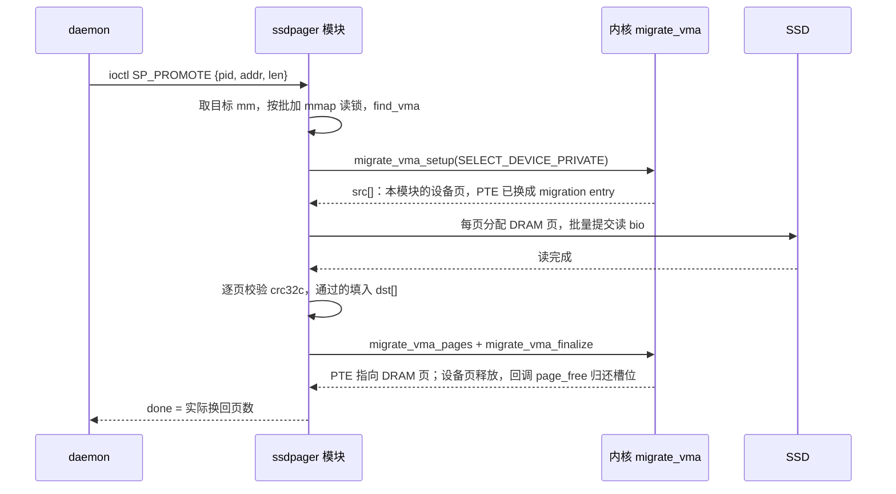

# ssdpager

不经 Linux swap，把进程的私有匿名页换出到 SSD 的内核模块 PoC。SSD 注册为 `MEMORY_DEVICE_PRIVATE` 设备内存，换入换出走 `migrate_vma_*()`，缺页走 `dev_pagemap_ops.migrate_to_ram`。设计、边界与实测见 [`../../ssdpager-页面接管与独立分页-调研验证报告.md`](../../ssdpager-页面接管与独立分页-调研验证报告.md)。

| 文件 | 内容 |
|---|---|
| `ssdpager.c` | 内核模块 |
| `ssdpager.h` | `/dev/ssdpager` 的 ioctl 定义：区间 `SP_EVICT`/`SP_PROMOTE`、离散页 `SP_EVICTV`/`SP_PROMOTEV`、`SP_EVACUATE`、页状态 `SP_QUERY`、事件轨迹 `SP_TRACE` |
| `sptest.c` | 控制工具兼测试程序 |

## 构建与运行

```sh
swapoff -a
LOOP=$(losetup --find --show --direct-io=on /home/ssdpager.img)   # 或直接用裸块设备
make KDIR=/home/kernel-olk6.6
insmod ssdpager.ko dev=$LOOP
./sptest basic 1024          # 其余子命令见 ./sptest 的用法输出
./sptest perf 2048 mixed    # 换出一半后测被动缺页代价（见报告 §5.6）
./sptest lead; ./sptest lead rand 300   # 提前量扫描（见报告 §5.7）
./sptest rate               # 主动换入吞吐 vs 批量大小（升序 LBA），含散页批量
./sptest rate rev           # 同上但降序提交
./sptest slots 1024         # 随机缺页 + 重新换出后的槽位连续度（见报告 §5.9）
./sptest vec                # 离散页批量、过期丢弃、页状态查询
./sptest trace              # 缺页轨迹与预取记账（命中/浪费/迟到/漏报）
./sptest evict PID; ./sptest promote PID; ./sptest evacuate; ./sptest stat
```

## 给 daemon 的接口

| 用途 | 调用 | 要点 |
|---|---|---|
| 预取一组散页 | `SP_PROMOTEV {pid, addrs, nr, deadline_ns}` | 按数组顺序处理，最紧迫的放前面；256 页一批并发读；到期未开始的条目丢弃，`dropped` 返回条数 |
| 换出一组冷页 | `SP_EVICTV` | 同一批写出的页在盘上连续 |
| 取缺页轨迹 | `SP_TRACE {buf, nr}` | 每条 `{ts_ns, addr, pid, type, lat_ns}`；读走即消费；环 65536 条，溢出覆盖最旧并计 `lost` |
| 判定预取结果 | `SP_QUERY {pid, addrs, nr, states}` | 窗口到期后查预取过的页：`SP_PG_YOUNG` 命中，`SP_PG_OLD` 浪费 |

事件类型：`SP_EV_FAULT` 漏报（缺页，带服务时间）；`SP_EV_LATE` 访问被在途的换入批阻塞；`SP_EV_EVICT_WAIT` 访问被在途的换出批阻塞（冷页选错的信号）。后两者靠 `migration_entry_wait` 上的 kprobe，`sptest stat` 里 `wait_probe 1` 表示已挂上。一条事件对应一次被阻塞的访问，不带等待时长。

调用是同步的，并发靠多线程；单调用越大吞吐越高，但其中每一批（256 页）在读完前会阻塞访问它的线程。

## 主动换入流程（`SP_PROMOTE`）

控制进程发一次 ioctl，模块按 256 页一批把目标进程指定区间内在 SSD 上的页读回并重新映射，不经过缺页。



| 步骤 | 函数 | 说明 |
|---|---|---|
| 入口 | `sp_ioctl` | 需要 `CAP_SYS_ADMIN` |
| 定位与切批 | `sp_do_range` / `sp_do_vec` | 每批单独加 `mmap_read_lock`，上限 `SP_BATCH`（256 页）；跳过 `VM_SPECIAL`、hugetlb、共享映射、DAX |
| 冻结 | `sp_batch_add` | 每段连续区间一次 `migrate_vma_setup`，只收集 `pgmap_owner` 为本模块的页 |
| 读、校验、提交 | `sp_batch_read`、`sp_batch_run` | 整批读在一个 `blk_plug` 内提交，读完后各段依次 `migrate_vma_pages/finalize` |
| 校验 | `sp_read_check` | 对比换出时存在 `zone_device_data` 里的 crc32c |
| 槽位归还 | `sp_page_free` | 设备页引用归零时回调 |

注意：

- 从 `migrate_vma_setup` 到 finalize 之间，目标进程访问这批页会阻塞，最长一批的读时间。
- 读错、校验错或 DRAM 分配失败的页留在 SSD 上，不计入 `done`，不发信号；应用之后访问到读错/校验错的页时在缺页路径上收到 SIGBUS。
- 模块不限速，节流由调用方切分区间实现。
