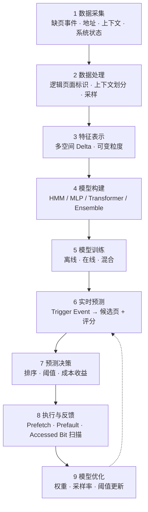
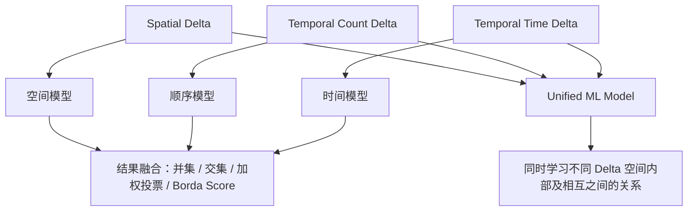

# MEXT 端到端建模流程

综合三篇 MEXT 专利，整体建模过程可归纳为 **数据采集 → 数据处理 → 特征表示 → 模型构建 → 模型训练 → 实时预测 → 预测决策 → 执行与反馈 → 模型优化** 九个阶段。

MEXT 的核心不是"用 Transformer 预测内存地址"，而是学习历史内存访问事件及其上下文之间的关联，预测未来可能发生的页面缺失，并用真实访问结果持续修正模型。以下内容仅依据三篇专利公开的技术方案归纳，不引入 POC 工程设计；流程顺序为综合归纳，并非专利原始附图。

## 1. 整体流程

## 2. 各阶段详解

### 2.1 数据采集（Telemetry Collection）

第一篇专利由操作系统向 AI/ML 组件提供连续事件流（Event Stream），其中最主要的是 Page Miss Event，其余为可选上下文。下表为三篇专利披露指标的综合分类（前 8 类为原始遥测，第 9 类为派生特征，第 10 类为训练/反馈数据，第 11 类为决策指标）：

| # | 指标类别 | 主要内容 | 建模价值 |
|---|---|---|---|
| 1 | 基础上下文信息（Context Information） | 进程 ID（PID）、线程 ID（TID）、进程名称、程序计数器（PC）、返回程序计数器（Return PC）、进程及线程调度、虚拟地址空间创建与销毁 | 区分不同进程、线程及程序执行上下文，学习特定上下文中的页面访问规律 |
| 2 | 页面地址信息（Page Address Information） | 虚拟地址、页面在进程地址空间分区中的偏移、物理交换空间偏移（Swap Offset）、文件映射信息（Inode、Name、Dnode、Block Offset） | 建立页面逻辑标识，描述页面间的空间关联，为地址 Delta 表示及页面访问预测提供基础 |
| 3 | 页面换入换出信息（Page Swapping Information） | 页面缺失（Page Miss）、页面命中（Page Hit）、页面换入（Swap-in）、页面换出（Swap-out）、换出时间、换出计数、已换出页面集合 | 学习页面缺失序列及换出行为之间的关联，构建空间 Delta 和时间 Delta，预测未来可能需要换入的页面 |
| 4 | 页面访问行为（Page Access Behavior） | 最近 N 次页面访问记录、首次访问时间、最近使用时间、未访问时间超过阈值、短暂访问后转为未访问、换出后短时间内再次访问、页面访问位（Accessed Bit） | 描述页面时间局部性、冷热状态、访问生命周期及触发页（Trigger Page）之间的关联，为页面预测和换出抑制提供依据 |
| 5 | 页面属性信息（Page Attributes） | 页面访问权限（Read、Write、Execute）、页面共享状态、虚拟地址空间分区（Heap、Stack 等） | 推断页面用途、进程间通信关系及不同内存区域的访问特征，辅助页面访问预测 |
| 6 | 进程运行状态（Process Runtime Status） | 页面换出时的进程地址空间大小、累计缺页数据（Major、Minor 及其他缺页）、累计运行时间、I/O 等待状态、工作集大小 | 描述进程内存需求、访问频繁程度和换页活动，辅助判断页面未来被访问的可能性及访问时机 |
| 7 | 系统运行状态（System Runtime Status） | 压力停顿信息（PSI）、CPU Load、I/O Activity、系统利用率统计 | 感知系统资源压力及运行状态变化，辅助识别应用程序不同的运行阶段（Phase Change） |
| 8 | 性能计数器指标（Performance Counters） | Cache Miss、TLB Miss、硬件性能计数器、软件性能计数器 | 补充操作系统层面的访问上下文信息，辅助识别工作负载阶段变化及不同的内存访问行为 |
| 9 | 页面时空关联特征（Spatial & Temporal Delta） | 虚拟地址 Delta、物理交换空间 Delta、已换出页空间 Delta、换出顺序 Delta、换出时间 Delta | 将大规模地址预测问题转换为有限的相对距离预测问题，缩减模型输出类别，扩大有效预测范围，学习页面间的空间及时间局部性 |
| 10 | 预测结果及访问反馈（Prediction Feedback） | 预测页面集合、实际缺页集合、预测评分、实际访问结果、页面访问指示信息、访问及时性判定、错误预测概率（Pbad） | 比较预测结果与真实访问行为，更新模型权重、评估预测效果，并支持预测模型的持续学习和自适应优化 |
| 11 | 提前缺页成本收益（Prefault Cost & Benefit） | 错误预测概率（Pbad）、正确预测概率（Pgood）、错误提前缺页处理成本（C）、正确提前缺页处理收益（B） | 建立量化成本收益模型，判断预测页面是否值得执行 Prefault，降低错误预测造成的额外系统开销 |

### 2.2 数据处理（Data Processing）

采样发生在进入特征表示之前：先按上下文把事件流切成独立序列，再在每个序列上做子序列采样。专利给出一条 Transformer 采样示例：连续采集 32 个事件、跳过 128 个，即 20% 采样率。

| 处理方法 | 主要内容 | 目的 |
|---|---|---|
| 逻辑页面标识 | 利用进程信息、地址空间分区及页面偏移识别页面 | 建立页面之间稳定的逻辑关系 |
| 上下文划分（Context） | 按进程、线程或虚拟地址空间组织事件 | 区分不同访问模式 |
| 连续子序列采样（Subsequence Sampling） | 选择部分连续访问事件作为模型输入 | 保留局部访问规律，降低训练开销 |
| 自适应采样（Adaptive Sampling） | 根据模型准确率及改善情况动态调整采样率 | 平衡预测效果与计算开销 |

### 2.3 特征表示（Feature Representation）

直接预测完整页地址会导致输出类别爆炸（Class Explosion）。第二篇专利改用**相对距离 Delta**：Type I、II 为已有技术，Type III、IV、V 为其实质新增。

| 特征类型 | 特征表示 | 计算依据 |
|---|---|---|
| Type I | Virtual Address Delta | 虚拟地址空间中的页面距离 |
| Type II | Physical Swap Delta | 物理交换空间中的页面距离 |
| Type III | Spatial Delta | 已换出页面按虚拟地址排序后的相对距离 |
| Type IV | Temporal Count Delta | 已换出页面按换出顺序排列后的相对距离 |
| Type V | Temporal Time Delta | 已换出页面之间的换出时间差 |

第二篇专利另有**可变粒度（Variable Granularity）**表示：近处页面用精细粒度、远处用粗粒度，以扩大有效预测覆盖范围。

### 2.4 模型构建（Model Construction）

第一篇专利明确列出四类候选模型，并说明 HMM、Transformer、MLP 均做过成功测试；第二篇专利补充两种组织方式——多模型集成与统一模型。专利未限定必须使用 Transformer。

| 模型 | 英文名称 | 建模方向 |
|---|---|---|
| 隐马尔可夫模型 | Hidden Markov Model（HMM） | 学习连续事件与隐藏运行状态之间的关系 |
| 多层感知机 | Multilayer Perceptron（MLP） | 学习输入特征与页面访问结果之间的非线性关系 |
| Transformer | General Purpose Transformer | 学习内存访问事件序列中的关联模式 |
| 集成模型 | Ensemble Model | 组合不同类型的预测模型 |

### 2.5 模型训练（Model Training）

| 训练方式 | 主要过程 |
|---|---|
| 离线训练（Offline Training） | 利用此前采集的应用内存访问数据训练预测模型 |
| 在线训练（Online Training） | 应用运行期间持续观测事件，动态学习访问模式 |
| 混合训练（Hybrid Training） | 先离线训练，再通过运行时反馈持续优化模型 |

专利允许从随机初始化开始在线学习，待模型具备一定预测能力后再启动主动页面推送。

### 2.6 实时预测（Online Prediction）

第一篇专利引入 Trigger Event / Trigger Page：检测到有预测价值的事件时，模型依据历史学习结果预测未来缺页。

| 模型组成 | 主要内容 |
|---|---|
| 输入 | 当前触发事件、当前缺页、近期缺页历史、上下文信息及 Delta |
| 学习目标 | 未来页面访问模式 |
| 推理目标 | 未来可能被访问的已换出页面 |
| 模型输出 | 预测页面集合、Delta、访问评分，或有序候选页列表 |

抽象表示为 $\hat{Y}_t = f_\theta(X_t)$，其中 $X_t$ 为当前事件及历史上下文特征，$\theta$ 为训练所得参数，$\hat{Y}_t$ 为未来页面访问预测。这是对专利描述的数学抽象，非专利给出的模型公式。

以虚拟地址 Delta 为例的输出形态（原理演示数据，非专利实测）：

| 候选页 | Delta | 访问评分 |
|---|---|---|
| P120 | +4 | 95% |
| P124 | +8 | 86% |
| P128 | +12 | 79% |

### 2.7 预测决策（Prediction Decision）

第一篇专利并不把所有预测页直接换入 DRAM，而用 Access Score 判断迁移价值，再按固定或动态阈值决定实际推送数量。

| 评分依据 | 含义 |
|---|---|
| Access Probability | 页面在未来一定数量的访问操作内被访问的概率 |
| Relative Access Probability | 候选页比 DRAM 中较冷页面更早被访问的可能性 |
| Expected Access Time | 距离预计访问页面的时间 |
| Available Space | 目标内存可用空间 |
| Available Bandwidth | 页面传输可用带宽 |
| Prediction Success / Failure | 历史预测成功或失败情况 |

第二篇专利允许用预测结果抑制即将被访问页面的换出（Swap-out Suppression）。第三篇专利给出 Prefault 成本收益判据：仅当预期收益大于预期成本时执行 Prefault。

$$C \times P_{bad} < B \times P_{good}, \qquad P_{good} = 1 - P_{bad}$$

| 参数 | 含义 |
|---|---|
| $C$ | 错误提前缺页处理的成本 |
| $B$ | 正确提前缺页处理的收益 |
| $P_{bad}$ | 错误预测概率 |
| $P_{good}$ | 正确预测概率 |

### 2.8 执行与反馈（Feedback Collection）

第三篇专利指出：Prefault 消除了本会发生的缺页，模型因此失去部分训练信号。故需保留可观测的真实缺页与访问位。

| 反馈方法 | 主要原理 | 反馈内容 |
|---|---|---|
| 实际缺页反馈 | 观察后续真实发生的缺页 | 实际缺页页面 |
| Feedback via Sampling | 对部分预测页面不执行 Prefault | 保留真实缺页信号 |
| Feedback via Scanning | 扫描页面访问位（Accessed Bit） | 判断预测页面是否被访问 |
| Temporal Sampling | 在指定时间窗口内抽样扫描 | 降低反馈扫描开销 |
| Spatial Sampling | 对选定地址区域禁用 Prefault | 保留模型训练数据 |

每个反馈周期的产物是正确预测、错误预测、漏预测三类标签及由此估计的错误概率 $P_{bad}$，直接进入 2.7 的决策判据与 2.9 的参数更新。

### 2.9 模型优化（Model Optimization）

第二篇专利的 Implementation Considerations 描述：比较预测缺页集合与实际缺页集合，算误差后经梯度下降/反向传播更新权重。专利特别指出损失可同时包含页面是否命中、访问时间顺序、以及从慢速介质读取页面的延迟；但未公开各项的确切公式与权重。

| 损失维度 | 建模含义 |
|---|---|
| 页面预测误差 | 预测页面与实际访问页面之间的差异 |
| 时间顺序误差 | 预测到正确页面，但预测访问顺序错误 |
| 页面读取延迟 | 页面读取成本及预取顺序对实际性能的影响 |

对神经网络模型的抽象表达（专利所述梯度下降的一般形式，非 MEXT 披露的具体损失）：

$$L = \mathcal{L}(Y, \hat{Y}), \qquad \theta_{t+1} = \theta_t - \eta \nabla_\theta L$$

其中 $\eta$ 为学习率。更新后的权重回到 2.6 的推理，采样率与决策阈值同时由 2.8 的反馈调整，构成闭环。

## 3. 三篇专利的建模贡献

| 建模维度 | 专利一 | 专利二 | 专利三 |
|---|---|---|---|
| 建模对象 | 页面访问事件及上下文 | 页面间的相对时空关系 | 预测结果及提前缺页收益 |
| 数据采集 | 广泛遥测指标 | 地址及换出信息 | 实际访问反馈 |
| 数据处理 | 上下文划分、自适应采样 | 有序数据结构、多维 Delta | 时间及空间反馈采样 |
| 特征工程 | 页面访问及上下文特征 | 空间 Delta、时间 Delta、可变粒度 | 错误概率及成本收益 |
| 模型结构 | HMM、MLP、Transformer、Ensemble | 单一融合模型、多模型集成 | 不限定基础预测模型 |
| 模型训练 | 离线训练、在线训练 | 预测误差、梯度下降、反向传播 | 保留及恢复训练反馈 |
| 模型输出 | 候选页面及访问评分 | Delta 及候选页面 | Prefault 决策 |
| 优化目标 | 提高页面预测能力 | 提高预测准确率及覆盖范围 | 降低缺页开销及错误预测成本 |

## 4. 披露与未披露边界

| 建模内容 | 披露情况 |
|---|---|
| 原始采集指标 | 已披露 |
| 上下文划分方法 | 已披露 |
| 固定及自适应采样 | 已披露 |
| 多空间 Delta 特征表示 | 已披露 |
| 可变粒度特征表示 | 已披露 |
| 候选模型类型 | 已披露 |
| 多模型集成及预测融合方法 | 已披露 |
| 离线及在线训练机制 | 已披露 |
| 损失函数设计方向 | 已披露 |
| 梯度下降及反向传播 | 已披露 |
| 预测评分及筛选机制 | 已披露 |
| Prefault 成本收益模型 | 已披露 |
| 预测反馈机制 | 已披露 |
| 特征归一化方法 | 未详细披露 |
| Embedding 编码方式及维度 | 未详细披露 |
| Transformer 网络层数 | 未详细披露 |
| Attention Head 数量 | 未详细披露 |
| 模型参数量 | 未详细披露 |
| 具体训练数据集 | 未详细披露 |
| 完整输入输出张量格式 | 未详细披露 |
| 损失函数完整数学表达式 | 未详细披露 |
| 优化器及学习率 | 未详细披露 |
| 商业模型最终实现 | 未详细披露 |

## 5. 总结

只聚焦模型本身时，流程可压缩为一条链：**原始遥测（访问事件 + 上下文）→ 预处理（逻辑标识 + 上下文划分 + 采样）→ 特征工程（Spatial / Temporal Delta）→ 训练（HMM / MLP / Transformer / Ensemble）→ 推理（未来缺页及候选页）→ 反馈（Page Fault + Accessed Bit）→ 参数更新（损失 + 反向传播）**，循环回到推理。

其核心建模思想是：基于上下文的内存访问序列学习、多空间 Delta 特征表示、未来缺页预测，以及真实访问驱动的持续反馈学习。

## 6. 参考来源

| 编号 | 专利名称 | 重点参考位置 | URL |
|---|---|---|---|
| [1] | US20240427493A1 — Intelligent, Predictive Memory Management System and Method | FIG.2、Table 1、AI Learning and Prediction Processing Module 220、Claim 5–26 | https://patents.justia.com/patent/20240427493 |
| [2] | US20260154153A1 — Memory Management Using Flexible Representations for Page Prediction | Table 1、ML-Based Prefetchers、Leveraging Multiple Delta Types、Multi-Context Management、Implementation Considerations | https://patents.justia.com/patent/20260154153 |
| [3] | US20260259814A1 — Efficient Page Prefetching with Flexible Prefaulting | Feedback via Sampling、Feedback via Scanning、Claim 1、Claim 17–23、Claim 30–31 | https://patents.justia.com/patent/20260259814 |
