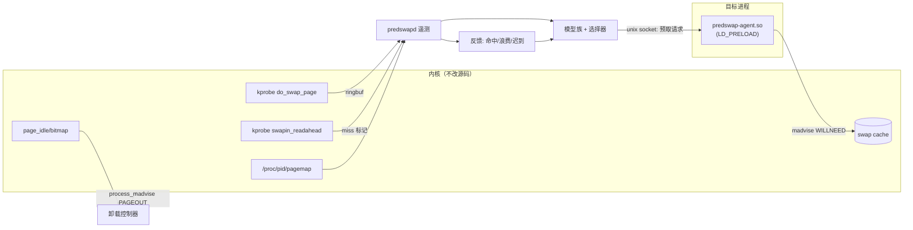

# predswap 设计规格（v0.2 + P1 修订，见附录 A）

**日期：** 2026-11-19
**状态：** Phase 0 完成（探测报告）；**P1 已交付并通过出口条件**（实现修订见附录 A）。下一阶段 P2：M0–M3 预测器 + 选择器。
**对标：** AMD MEXT（《AMD-MEXT-技术洞察报告.md》）。借鉴 FarSight、xTier、ArtMem（各自洞察报告 + 《内存分层方案对比.md》）。
**问题层次：** 内存分层里的**闪存 swap 预取 + 冷页卸载**（DRAM↔SSD）；和 FarSight / MEXT 一样属于预取侧问题，不是 CXL/NUMA 页放置。

---

## 1. 目标与需求

### 1.1 一句话

不打内核补丁，在 Kunpeng/openEuler 22.03（内核 5.10，cgroup v1）上做一个 MEXT 式系统：eBPF 双 entry kprobe 观测 swap 缺页流，按页龄把冷匿名页 `MADV_PAGEOUT` 换出到 SSD、靠 cgroup 限额压力释放 DRAM，用在线自选的模型族预测即将缺页的已换出页，经目标进程内的 LD_PRELOAD agent 用 `madvise(MADV_WILLNEED)` 预取进 swap cache。同一台机器、同一 DRAM 预算下，性能超过 Linux 原生 swap 和 TMO 式主动回收。

### 1.2 已确认的需求

| 项 | 决定 | 备注 |
|---|---|---|
| 慢层 | 闪存 swap | 实测 qd1 5 562 IOPS / 0.166ms，qd32 19 085 IOPS（探测报告 §2-10） |
| 平台 | Kunpeng 920 + openEuler 22.03 SP4 / 5.10，cgroup v1 | v0.1 写的"24.03"是 ENV 记录错误 |
| 内核改动 | 不打补丁；eBPF + 现有 syscall/cgroup；`.ko` 仅后备 | |
| 预测引擎 | 模型族在线自选（启发式 + 小 NN） | 不要求离线训练 |
| 成功标准 | 同机相对基线（§8.3 预注册门槛） | 不和 MEXT 自报数字比 |
| 负载 | memcached（nginx 前置）、GAP PR/BFS、XGBoost、合成微基准 | |
| 语言 | eBPF CO-RE（C）+ Rust 用户态 + agent.so | |

### 1.3 非目标（v1）

CXL/NUMA 放置；文件页分层；THP（实验统一 never）；跨节点池化；x86 PEBS/AVX512。

---

## 2. 从参考系统继承什么

| 来源 | 继承 | 不继承（原因） |
|---|---|---|
| MEXT | 遥测→AI 引擎→执行者三件套；卸载反馈式、回流预测式；模型族在线选择；RAM View 6 档页温度（<15s/<1min/<2min/<3min/<5min/>5min，报告 §2.2） | 专用裸盘、禁其他 swap、关 Secure Boot、mextd 不可停（§2.3）。本设计全动作是建议性 syscall，守护进程死了退化成原生 swap |
| FarSight | 只用缺页序列预测；后继表（future map）；小词表 token；推理藏在 I/O 等待里 | 内核内推理、5.5K 行内核改动（§3.1）、AVX512、离线 trace 训练 |
| FarSight 缺口 | 补论文有、代码无的 PC 通道（§4.1）——但 arm64 BPF 取用户 PC 的方法待 P1 验证，M4 先不带 PC | |
| xTier | 双向不同判据（回流预测、判冷确定性）；逐页冷静期；按地址排序合并成段再批量下发（对比文档 §1.3） | eBPF 内 INT8 推理（SSD 预算宽，用户态够）；按负载离线训练 |
| ArtMem | 直方图容量反推阈值（从最老桶累加，凑够要腾的量，§5）；log2 桶 | 改内核；struct page 死空间 |
| 本机实证（探测报告） | H 余量机制必需（WILLNEED 在限额处静默失效，§2-6）；PAGEOUT 后 swap cache 逐出交给限额压力（§2-5） | |

**决策预算依据：** SSD 随机读 166µs，比 FarSight 面对的 RDMA（~2µs）宽两个数量级 → 推理放用户态，事件→下发 p99 ≤1ms，前瞻 d 覆盖该窗口（§5.4）。

---

## 3. 架构



| 组件 | 形态 | 职责 | MEXT 对应 |
|---|---|---|---|
| `predswap-bpf` | eBPF CO-RE（C） | 双 kprobe 事件流，按托管 cgroup id 过滤，ringbuf 输出 | MEXT Driver |
| `predswapd` | Rust 守护进程 | 遥测状态、模型族、选择器、卸载控制器、IO 预算、录制 | AI Engine + mextd |
| `predswap-agent.so` | C，LD_PRELOAD 注入目标进程 | 收预取请求，进程内 `madvise(MADV_WILLNEED)`（探测报告 §2-2/4：跨进程 WILLNEED 在 5.10 不可用） | — |
| `predswapctl` | Rust CLI | 状态/温度分布/改配置/开关成员；与 daemon 走 unix socket JSON lines | RAM View + mext-config |
| `predswap-record` | 工具 | 录事件流 + PAGEOUT 批次 + agent 请求 → trace 文件；离线 replay 喂给各成员出准确率/覆盖率/迟到率 | — |
| `predswap.ko`（后备） | 可加载模块 | 仅当 eBPF kprobe 不可用 | — |

predswapd 线程：**ingest**（钉核：ringbuf → 状态 → M0–M3 推理 → 派发，每事件预算 30µs）+ **background**（M4 训练、pagemap 对账、页龄扫描、卸载控制）。合计 CPU 预算见 §7。

---

## 4. 遥测

### 4.1 swap 事件（主信号）

两个 entry kprobe（均已在探测报告 §2-8 验证），**不用 kretprobe**（该内核上 kretprobe 会挤掉同函数的 kprobe 事件，探测报告 §2-9）：

- `do_swap_page(vmf)`：每次访问换出页必经（WILLNEED 只装 swap cache 不建映射，PTE 仍是 swap 项；探测报告 §2-3 证实）。读 `vmf->address`；
- `swapin_readahead(entry, gfp, vmf)`：仅 cache miss（major）路径调用。同读 `vmf->address` 作 miss 标记。注意 WILLNEED 走 `read_swap_cache_async` 逐页，**不经过**此函数（`code/ArtMem/kernel/mm/madvise.c:187-217`），预取自身不产生 miss 事件。

事件结构（ringbuf，32B；buffer 默认 64MB——实测负载 7s 产生 27K 事件 ≈ 4K/s，64MB 覆盖分钟级突发；满则丢事件并累加 `ev_dropped`，绝不阻塞缺页路径）：

```c
struct swap_ev {
    u64 ts_ns;      // kprobe 时刻
    u64 va;         // PAGE_MASK 后的地址
    u64 cgid;       // BPF map managed_cgids 过滤
    u32 tgid, tid;  // 多线程按 tid 分流
    u8  kind;       // EV_SWAPIN(do_swap_page) | EV_MISS(swapin_readahead)
    u8  _pad[3];
};
```

**分类规则（合并到"一次访问"，探测报告 §2-8 验证了原始计数）**：VM_FAULT_RETRY 会使同一 (tid,va) 产生第二次 do_swap_page（慢事件后跟一次快的），所以：

| 观测序列（同 tid+va，窗口 ≤50ms） | 分类 |
|---|---|
| do_swap_page + MISS + do_swap_page | **major 缺页**（真读盘；两次事件间隔 ≈ IO 等待，代替 lat_ns） |
| do_swap_page + do_swap_page（无 MISS，间隔 > 200µs 的重试对） | **迟到**（预取在途：在途 folio 已入 swap cache，故 lookup 命中、不调 swapin_readahead，但页锁未释放，缺页 RETRY 等待。**P1 实现修正**：v0.2 曾写成"MISS+配对"，错——在途页在 cache 里，无 MISS） |
| 单条 do_swap_page，无 MISS、无重试对 | **及时命中**（预取或残留 cache） |
| MISS 无 do_swap_page 前导 | 内核 readahead 的簇内页，丢弃 |

**归因前提：** 运行时设 `page-cluster=0`、`vma_ra_enabled=false`（本机两个旋钮都在，探测报告 §1），退出恢复；内核预读能力由 M1 覆盖，swap cache 命中全部归因于自己。

**用户 PC 通道：** arm64 BPF 里读用户态 PC（`task_pt_regs`）的方法待 P1 验证；M4 默认仅 VPN-delta token，PC 验证通过后作为增强通道（λ_PC 消融在 §8.4）。

### 4.2 换出状态

托管进程的"已换出页集合"：
- 自己的 PAGEOUT 批次直接记账；
- 内核自主回收靠周期 pagemap 对账发现（PM_SWAP 位，私有匿名页 root 可见——探测报告 §2-7；**注意 MAP_SHARED 匿名 = shmem 换出后 pagemap 读全 0**，负载选择避开）；
- 全量对账周期 30s，每轮读 ≤64MB pagemap；
- 预测只对"已换出 + 无在途预取"的页派发。

### 4.3 页龄（AgeSource = page_idle，已确认）

后端固定为 `/sys/kernel/mm/page_idle/bitmap`（CONFIG 已开，探测报告 §1；DAMON/MGLRU 本机都没有）。
- PFN 从 pagemap 取，access bit 标记 idle 后下轮扫描判龄；换出页跳过（页不在内存）；
- 输出每页 log2 秒桶 + MEXT 口径 6 档温度分布；
- **成本核算：** 24GB ≈ 6.3M 页，全扫 = pagemap 读 48MB + bitmap 读写 ~2MB；扫描周期 10s（对齐 MEXT 最细档 <15s），单次扫描 CPU ≤0.05 核·s，只扫托管进程的地址空间而非全机。

---

## 5. 预测引擎（模型族）

### 5.1 接口

```rust
trait Predictor {
    fn observe(&mut self, acc: &Access, ledger: &mut Ledger);
    fn predict(&mut self, acc: &Access, d: usize, out: &mut Vec<Vpn>);
    fn mem_bytes(&self) -> usize;
}
```

`Access` 是 §4.1 合并后的一次访问。所有成员对每个事件 observe；**predict 有每事件预算**（见 5.2/5.3），只有选择器分到额度的成员的预测会真正下发。

### 5.2 成员

| 成员 | 机制 | 针对模式 | 状态上限 | 每事件成本上限 |
|---|---|---|---|---|
| M0 Null | 不预测 | 不可预测负载兜底 | 0 | 0 |
| M1 Stride | 每 (tid,VMA) 记 4 次缺页 VPN 差；连续 2 次相同步长 s → 预测 va+k·s | 顺序/定步长扫描；取代内核预读 | 每 VMA 64B | ~0.1µs |
| M2 Successor | FarSight future map 用户态版：VPN→最近 2 个后继（LRU 计数淘汰）；沿链走 d 步 | 指针追逐、图遍历 | 每项 24B，总量 ≤托管内存 0.5% | ~1µs |
| M3 Co-evict | 同一 PAGEOUT 批次中地址相邻的页为一组；组内页缺页时预取其余页。**共访问率定义：** 每组维护 16-bit 计数，组内页被访问则整组计数右移衰减后计 1；`共访问率 = 计数/16`，低于 1/16 的组失效删除 | 一起冷一起热的数据结构（memcached slab、图分区） | 每组 16B+位图 | ~0.2µs |
| M4 TinySeq | 2 层 GRU，隐维 32（约 1.2 万参数），输入 = 最近 T=32 次访问的 VPN-delta token（K=64：0–61 表示 ΔVPN∈[−31,−1]∪[1,31]，62=走 M2 第一后继，63=不预测），纯 Rust + **SVE2** 内积 | 有程序逻辑、无简单规则 | 参数 ≤64KB | 每事件 ≤10µs（d≤4；事件率>20K/s 时按 1/8 采样） |

**M4 每事件预算是硬上限**（v0.1 评审结论：d=32 全量影子推理在 6.7K events/s 时即 >4 核）。超预算成员本 epoch 降级为 observe-only。

**M4 在线训练：** background 线程滑窗 next-token SGD，每 60s 一轮，每轮采样 8K 长度 32 的窗口、≤200ms CPU（v0.1 的 64K×200ms 算不过账，评审结论 3）；冷启动 50K 事件不参与选择。P3 开头用实测定稿。

### 5.3 反馈与选择器

每条预测记入影子账本 `(vpn, member, t_pred)`，命中窗口 W=2s：
- **命中：** W 内该 vpn 出现"及时命中"（§4.1 表第 3 行）。**在被访问前又被换出/逐出 cache 的算浪费**（不会表现为及时命中，自动归入）；
- **浪费：** W 内无访问且已下发；
- **迟到：** 下发过但事件分类为"迟到"。

每 epoch（1s）：`U_m = hits_m − λ·wasted_m`，λ 默认 0.5（P1 按 qd1/qd32 实测回调）。选择器 Hedge：`w_m ← w_m·exp(η·U_m/N)`，η=0.5，归一化后按权重分配下 epoch 预取额度。**多条预测同一 vpn 时全命中记功、全浪费记过**（选择器要度量预测质量，与派发重复无关）；实际派发去重一次。M0 权重最高 = 关预取，是 G2 的保底。

全局指标（predswapctl）：准确率 = 下发且及时命中/下发；覆盖率 = 及时命中的 swap-in/全部 swap-in；迟到率。

### 5.4 前瞻距离、IO 预算与派发

- **d 自适应：** 使"事件间隔 p50 × d ≥ 预取完成延迟 p90"，d ∈ [1,32]；预取完成延迟 = 派发→该页"及时命中"的最短间隔统计；
- **IO 预算：** 实测 qd32 19 085 IOPS，预取令牌桶默认 40%（≈7.6K 读/s）。major 的 p90 IO 等待超空载基线 2 倍时额度减半，恢复后线性回升（AIMD）；
- **派发路径：** predswapd 按 VPN 排序合并成段 → unix dgram socket 发给目标进程的 agent → agent `madvise(WILLNEED)`。dgram 天然丢弃过载请求（背压由 IO 令牌桶承担）。段级去重：在途段内 vpn 不重复。

---

## 6. 卸载控制器

判冷不用模型，只用确定性页龄（不对称原则：误判回流浪费一次读，误判换出每次访问都付 166µs）。

- **容量目标：** 目标变量 = cgroup `memory.usage_in_bytes`（v1，实测有效，探测报告 §1）≤ `B − H`，H = max(2%·B, 64MB)。**H 是机制必需**：限额处 WILLNEED 静默无效（探测报告 §2-6）；
- **阈值：** ArtMem 式直方图反推（页龄 log2 桶从最老往新累加，累计 ≥ `usage − (B−H)` 时的桶即判冷阈值）；
- **执行：** 阈值以上的页按地址合并成段 → 跨进程 `process_madvise(MADV_PAGEOUT)`（5 参，flags=0，返回建议字节数；探测报告 §2-1），每轮上限 `max_pageout_mb=256MB`；
- **物理释放：** PAGEOUT 只解除映射，folio 留在 swap cache（探测报告 §2-5）；实际 DRAM 释放由 cgroup 限额对 swap cache 的逐出完成——这是特性不是缺陷：被逐出的只是"已经换出过的页"的 cache 副本，顺序仍由我们的 PAGEOUT 决定。pagemap 对账监控内核自主换出占比，>20% 告警；
- **无 `memory.reclaim`、无 PSI（cgroup v1，探测报告 §1）：** 护栏改用 memory.stat 的 pgmajfault 斜率——每 epoch 新增 major 超过阈值（默认 500/s）即暂停主动换出，等命中恢复；
- **冷静期：** 最近 C=30s 内 swap-in 过的页不进候选（xTier 冷静期）；C 内又被访问的页计乒乓；
- **周期 1s。** 关闭预测只跑此控制器 = 基线 B2。

---

## 7. 非功能需求

| 项 | 要求 | 依据 |
|---|---|---|
| CPU | predswapd 平均 ≤1 核、峰值 ≤2 核；eBPF 每事件 ≤2µs；agent ≤0.1 核 | MEXT 自称 2 核；xTier <4% |
| 内存 | predswapd RSS ≤ 托管内存 1% + 64MB（含 §5.2 各成员上限之和） | FarSight 上限 6.25%，取更紧 |
| 正确性 | `kill -9 predswapd` 应用无错误，退化为原生 swap | 与 MEXT"不可停"相反 |
| 权限 | root；BPF 加载 CAP_BPF/CAP_SYS_ADMIN；agent 注入 = 负载启动时 LD_PRELOAD（`systemd-run --scope -p MemoryMax=B` 同一命令里带环境变量） | |
| Secure Boot | 不要求关 | |
| swap 设备 | 实验期只启用 `/home/swapfile`（关 4G 分区，两设备并存时内核优先 4G 分区，探测报告 §1）。25% 档工作集上限受 swap 容量约束：WS ≤ B + swap总量 − 余量 → WS ≤ ~18GB；如需更大 WS 扩 swapfile | ENV swapon |
| 内核预读 | `page-cluster=0`、`vma_ra_enabled=false`，退出恢复 | §4.1 归因 |
| SSD 磨损 | 报告 pswpout 速率与折算 DWPD | MEXT 报告 §5.1 |
| 配置 | `/etc/predswap.toml`：cgroup 路径、H、λ、η、W、C、成员开关、IO 份额 | |
| 可观测 | `predswapctl status`：各 cgroup 常驻/换出、6 档温度、成员权重/准确率/覆盖率/迟到率、IO 额度、`ev_dropped`、乒乓计数 | MEXT RAM View |
| 进程发现 | 监控 cgroup tasks 文件（v1）+ pidfd 轮询退出；exec 后 pidfd 触发 agent 重连 | |

---

## 8. 评估

### 8.1 基线

| 编号 | 配置 |
|---|---|
| B0 | 全 DRAM，性能参照 |
| B1 | 原生 swap：`memory.limit_in_bytes=B`，默认 page-cluster=3 + vma_ra 开 |
| B2 | predswapd 只开卸载控制器（预测关闭），= TMO 式主动回收 |
| P | predswapd 全功能 |

（v0.1 的 B1'/B3——MGLRU、etmem——本机没有，删除，探测报告 §1。）

统一控制：仅 swapfile；THP never；`memory.swappiness=100`（每组，v1 按组设）；`systemd-run --scope -p MemoryMax=B` 限额并注入 agent；每 run 重启负载。

### 8.2 负载与预算

- memcached（nginx 前置；S1 稳态 Zipf、S2 相变轮转，拓扑沿用《nginx-ml-tiering-experiment-design.md》§2.2）、GAP PR/BFS、XGBoost；
- 合成微基准：顺序扫描（M1）、定步长（M1）、固定随机链表（M2/M4）、成块冷热（M3）、纯随机（期望收敛 M0）；
- B ∈ {100%, 75%, 50%, 25%} × WS；**WS ≤18GB**（§7 swap 约束），单 NUMA 节点内完成（每节点 31GB，排除跨节点延迟）；
- 每格 ≥3 reps 交错；统计方法沿用 nginx 方案 §9。

### 8.3 验收门槛（预注册）

X = 10%（与 nginx 方案一致）。pilot 前可改，之后不可。

| 门槛 | 条件 |
|---|---|
| G1 | B=50% 时 P 比原生最好（=B1，无 MGLRU/etmem 可比）快 ≥10%，≥2/3 负载成立 |
| G2 | 任何负载/预算下 P 不比 B1 慢 >3%（纯随机微基准专项检验） |
| G3 | P 比 B2 快 ≥10%（预测本身的贡献） |
| G4 | SLO 下 DRAM_min(P) ≤ 0.9 × DRAM_min(B1)（二分法沿用 nginx 方案 §6） |
| G5 | §7 全部满足 |
| G6 | 运行中 `kill -9 predswapd` 10 次，负载零错误 |

诊断指标（不设门槛）：各成员准确率/覆盖率/迟到率、权重轨迹、乒乓、IO 占比、pswpin/out。

### 8.4 消融

单成员 vs 全族+选择器（自选 ≥ 事后最佳单成员的 90%）；M4 去训练（只用 M2 捆绑）量化在线学习价值；PC 通道（P1 验证可用后）；λ、η、W、H、C、d 各扫一维。

---

## 9. Phase 0 结论（已完成，2026-11-19）

全部探测项已定：内核 5.10/cgroup v1/无 DAMON、MGLRU、etmem、reclaim、PSI、force_swapin；BTF + kprobe + BPF libbpf 在；idle page tracking 在；双 kprobe 事件模型与 WILLNEED/PAGEOUT 机制实测通过。细节与证据见探测报告（本仓库根目录）。

**遗留两项移入 P1 入口：**
1. eBPF kprobe 程序实际加载（机器无 clang/bpftool，需 yum 安装或本地生成 vmlinux.h/BPF ELF 后上传；libbpf.so 0.8.1 已在）；
2. page_idle 功能实测（PFN→bitmap 判龄走通）。

## 10. 里程碑

| 阶段 | 交付 | 出口条件 |
|---|---|---|
| P1 | 双 kprobe 事件流 + 归并分类器 + agent + 卸载控制器 + predswapctl + predswap-record/replay（=B2 可跑） | B2 在 50% 预算不比 B1 差；G5、G6 过；replay 管线能重放同一条 trace 复现指标 |
| P2 | M0–M3 + 选择器 + IO 预算 | 微基准上各成员按预期命中；G2 过；replay 上单成员准确率达标 |
| P3 | M4 在线训练（PC 通道视 P1 验证结果） | §8.4 消融跑通；M4 训练一轮实测 CPU 在预算内 |
| P4 | 完整评估 | G1–G6 报告（含负结果） |

P2 执行决定：本轮跳过 G2 作为进入 P3 的门槛，G2 实测状态为未通过（见附录 B）。P2 其余出口条件仍按表核对。

代码：`code/predswap/`（`bpf/`、`daemon/`、`agent/`、`ctl/`、`bench/`、`tools/record+replay`），独立仓库。

## 11. 风险

| 风险 | 影响 | 应对 |
|---|---|---|
| SATA SSD 19K IOPS，qd 扩展性 3.4× | 预取额度小、误预测代价高；结果不能外推 NVMe | 同机相对比较（已确认）；报告写明介质 |
| 用户态事件→派发 p99 >1ms | 迟到率高 | 增大 d；ingest 钉核 |
| 后继表冷启动（每页首次缺页必 miss） | 覆盖率上不去 | M1、M3 不依赖逐页历史，兜底 |
| 多线程缺页序列交错 | M2/M4 准确率降 | 按 tid 分流（事件已带） |
| agent 注入改变负载环境 | memcached/nginx 类服务可用环境变量启动，无侵入配置；对无法注入的进程（已有静态二进制）则不托管 | 执行器后备 `.ko`；G2 用同注入方式的对照组隔离 LD_PRELOAD 本身的影响 |
| 内核自主回收竞争 | 换出乱序 | 留 H；对账监控 >20% 告警 |
| cgroup 限额处预取静默失效 | 效果消失且无报错 | H 机制化；predswapctl 显示"WILLNEED 有效字节/请求字节"比值，<90% 告警 |
| 全局 sysctl 影响非托管进程 | 干扰其他负载 | 实验机专用 |

---

## 附录 A：P1 实现修订记录（2026-11-19，P1 完成后回填）

P1 已交付并通过出口条件（代码 `code/predswap/`，证据见各 bench 脚本输出）。实现过程中对 v0.2 的修正与补充：

| # | 修正/发现 | 依据 |
|---|---|---|
1 | §4.1"迟到"分类修正：在途预取页已入 swap cache，缺页无 MISS，表现为无 miss 的间隔重试对（表内已改） | `lookup_swap_cache` 先于 miss 分支（`code/ArtMem/kernel/mm/memory.c:3527`）+ T1 实测事件序列 |
| 2 | 事件结构定稿 32B（自然对齐尾部填充，v0.2 草写 28B 是错的）；kind 字段过滤、tgid 过滤表由 bridge stdin 行协议维护（v0.2 的 cgid 过滤在 cgroup v1 不可靠，改按 tgid） | T1 事件流验证 |
| 3 | bridge 需要 `RLIMIT_MEMLOCK=unlimited`（64M 下 EPERP）；daemon 启动时自行 setrlimit | 探测中复现 |
| 4 | page_idle 实操三点：bitmap 必须**读写**打开（只读打开时 write_at 静默失败，页龄永不清零——本次最大调试成本）；被测页必须已在 LRU（pagevec 未排空的新页写入被静默跳过，触碰 ≥15 页促使排空）；读位判龄协议 = 每周期读旧位→回写 1 重新武装 | `page_idle.c` 源码 + 受控实验（bench/idle_test.py） |
| 5 | 判冷阈值补最小页龄钳制 15s（`min_epochs = 15/scan_period`），对齐 MEXT 最细档；否则 scan 周期 5s 时 5s 空闲页即被换出，控制器变成额外换出 | 78% 预算首轮 B2 比 B1 多 4.4% major 的归因 |
| 6 | major 护栏的"速率"必须按秒折算（按扫描周期计会让 500/s 阈值变成 500/5s，形同虚设的反向错误）；重换页负载下绝对阈值会永久暂停控制器，改为可配置并在实验中用 3000/s | B2 首轮全程 paused=true 复现 |
| 7 | B2@50% 出口条件通过：3 reps 交错，B2 major 数均值 −1.0%（−2.5%/−0.7%/+0.2%），ops −0.4%（噪声级）。但该负载（tiers）下候选稀缺（冷却+页龄双闸后 ~700 页/tick），B2 ≈ B1 + 微扰——真实判别力要等 P2 预测开启后在 SLO/budget 扫描中体现 | bench/b1b2_50.sh |
| 8 | 事件流端到端验证：99.9% 落在已知工作集区域、miss 计数 ≈ getrusage majflt、swapin 计数 = 触碰页数 + RETRY 重试数（配对机制实证）；replay 同 trace 复现分类（100% 总量一致）；major 的 io_wait p50=175µs 与空载盘延迟吻合 | T1 验证 + daemon replay |
| 9 | agent 端到端验证：预取半区 majflt 8463→4160（近半），ACK 报告有效字节/请求字节 | T2 验证 |
| 10 | 机器事实补充：NUMA 节点 1 物理地址在 1TB 起，pagemap PFN ≈ 2.7 亿是正常的（勿当越界值误判）；`/proc/pid/status` 的字段是 `Tgid:`（小写 g，非 `TGid:`） | p0/b2 调试 |

P1 出口条件核销：B2@50% 不劣于 B1 ✓（#7）；G5 ✓（daemon 0.039 核、RSS 4.3MB，见 bench/g5.sh）；G6 ✓（10 次 `kill -9` + 重启，负载 100s 跑完 rc=0、`tiers verify bad=0` 数据完好，见 bench/g6.sh）；replay 复现 ✓（#8）。P1 交付物：`bpf/`、`bridge/`、`agent/`、`daemon/`、`bench/`（synth + 全部验证脚本），构建与运行方法见 `code/predswap/README.md`。

## 附录 B：P2 验证记录（未验收）

G2 均匀随机专项：`code/predswap/bench/g2_uniform.sh`，512 MiB 工作集、320 MiB 硬限额、60 s 稳态，成对共用种子，双方均不录 trace。目标机原始输出：`/tmp/g2-uniform.YUM9n2`。

| 种子 | B1（ops/s） | P（ops/s） | P 相对 B1 |
|-----:|------------:|-----------:|----------:|
|    1 |    14611.78 |   12790.41 |    −12.5% |
|    2 |    14589.37 |   12794.88 |    −12.3% |
|    3 |    14214.41 |   11922.62 |    −16.1% |

三对均超过 3% 回退门槛，G2 未过。该比较测量完整 P 相对 B1 的差异，不能单独归因于模型、执行器或内核预读。

归因对照：无 daemon、种子 1，关闭/开启内核预读分别完成 854016 ops / 60.113 s 和 854016 ops / 60.117 s；单对测试未复现完整 P 的回退。`PREDSWAP_SHADOW_ONLY=1` 保留观测、推理和卸载，跳过预测页派发，三个种子的配对吞吐仍分别回退 5.7%、7.0%、7.3%（`/tmp/g2-uniform.zNDAdn`）。该轮种子 1 的首个控制周期记录 usage=319 MiB、目标 256 MiB、pageout=317 MiB；pageout 表示建议量，不是已释放量。`offload::tick` 原先按整个阈值年龄桶选择候选，连续段合并期间未逐页检查剩余额度。现按向上取整的缺口页数与单轮硬上限页数取小，限制整轮及每个连续段。

限制卸载量后，三个种子首次建议量均为 63 MiB，完整 P 吞吐仍回退 8.3%、6.7%、7.0%（`/tmp/g2-uniform.ejzhax`）。该轮及此前脚本的 `--scan-period`、`--cooldown` 未映射到配置读取的 `_s` 键，不能视为 5 s / 20 s 配置的测量。

修正 CLI 映射和最小判冷周期向上取整后，完整 P 不录 trace 的三对稳态吞吐如下（`/tmp/g2-uniform.pe1jiz`）：

| 种子 | B1（ops/s） | P（ops/s） | P 相对 B1 |
|-----:|------------:|-----------:|----------:|
|    1 |    14491.45 |   13539.65 |    −6.57% |
|    2 |    13907.62 |   13503.07 |    −2.91% |
|    3 |    14559.65 |   13528.84 |    −7.08% |

三轮平均吞吐之比约为 94.4%，G2 未通过。

用户决定本轮跳过 G2 门槛，暂停该项排查和复测。保留上述负结果，纳入 P4 的 G1–G6 报告。

P2 结构化微基准复核。用目标机当前 `predswapd replay` 重放留存 trace，结果为影子账本的命中数 / 预测数。

| Trace          | M1             | M2              | M3            |
|----------------|---------------:|----------------:|--------------:|
| `p2_seq6k`     |      0/258308  |       0/552326  |           —   |
| `p2_seq20k`    |     26/630554  |      41/656262  |           —   |
| `p2_chain`     |     25/131757  |          0/532  |        71/950 |
| `p2_cb`        |   1166/117600  |   11609/471238  |  27302/277283 |

顺序与固定链表的预期成员未表现出稳定的影子命中。冷块上 M3 影子准确率为 9.8%，该轮在线 P 的 major fault 为 379596，B1 为 141406。§8 将成员准确率列为诊断指标且无数值门槛，现有结果不足以核销 §10 的 P2 成员出口条件。

上述 shadow_acc 来自 `predictors.rs` 的 `Ledger::on_access`，仅给窗口内被分类为 Hit 或 Late 的访问记功。预测地址正确、随后仍发生 Major 的情况不计命中。表中结果衡量现有 trace 上的影子记功，无法单独判定模型的地址预测准确率。

地址级复核。`replay` 新增 `address_matches`：预测后 W 内同进程同页被访问的次数，含访问仍为 Major 的情况，用以把地址预测能力与执行时效分开。重放留存 trace 结果如下（分子为 address_matches，分母为 preds）。

| Trace       | M1                  | M2                  | M3                  |
|-------------|---------------------|---------------------|---------------------|
| `p2_seq6k`  | 252936/259901 97.3% | 405093/552252 73.3% | —                   |
| `p2_seq20k` | 621873/629701 98.8% | 608535/655472 92.8% | —                   |
| `p2_chain`  | 127541/131855 96.7% | 276/511 54.0%       | 417/958 43.5%       |
| `p2_cb`     | 94913/118131 80.3%  | 160390/471395 34.0% | 119237/277327 43.0% |

两条顺序 trace 上，M1 的地址匹配率分别为 97.3%、98.8%，对应 Hit/Late 记功分别为 0、26 次。预测地址正确不意味着访问时能及时命中；仅凭这些计数不能区分未派发、到达太晚或提前被逐出。`address_matches` 不等于 §5.3 定义的全局准确率（下发且及时命中/下发）。

## 附录 C：P3 TinySeq 模型级实测（在线验收另计）

目标机 `m4_probe /tmp/p2_<负载>.psrec`，单线程 synth 的分类访问按时间排序，前 2/3 抽样训练、后 1/3 等距抽样评分。样本是缺页访问而非全部内存操作；对照为最近观察到的后继，不等价于在线 M2 的双后继计数策略。模型对象 56320 B。下表为单次运行，正确数指精确预测下一次访问的 VPN，未派发 IO。

| Trace  | 测试数 | GRU 发出 / 正确 | 最近后继发出 / 正确 | SGD 更新 / CPU ms | 完整窗口推理 p50 / p99（µs） |
|--------|-------:|----------------:|--------------------:|------------------:|------------------------------:|
| seq6k  |   2064 |     2064 / 2064 |         2064 / 2064 |      374 / 190.03 |                 281.99 / 291.11 |
| cb     |   2076 |     1469 / 1330 |          2076 / 942 |      374 / 190.08 |                 280.41 / 296.26 |
| chain  |   2075 |     2075 / 2074 |               1 / 0 |      386 / 190.48 |                 268.74 / 276.26 |

结论：一轮 CPU 预算不足以完成 8192 个训练窗口；32 步完整前向不能直接放进 ≤10 µs 的 ingest 路径。上述模型正确数是离线能力，不是实际派发覆盖率、及时命中数或吞吐收益。

在线消融：`bench/p3_m4.sh`，cb 100 s、种子 7、三种模式各一轮，原始日志 `/tmp/p3-m4.AzXUzq`。三轮均 `verify bad=0`。目标机 11 项集成测试全部通过。

| M4 模式 | 吞吐（ops/s） | cgmaj | M4 影子预测 | M4 派发记账 |
|---------|--------------:|------:|------------:|------------:|
| trained |         19112 |246884 |           0 |           0 |
| m2-only |         18863 |258238 |      101456 |        7777 |
| off     |         19069 |246411 |           0 |           0 |

trained：一轮完成 309 个窗口，CPU 195.10 ms。后台发布 84 个完整上下文预测；下半程查询 98335 次，缓存命中为零。8 次查询超过 10 µs，最大 30.18 µs，触发当 epoch 抑制。该机制控制开销但没有兑现 GRU 在该负载上的预测覆盖。三组吞吐不得解读为训练收益。PC 未启用；单成员/全族及参数扫描尚未验收。

增量推理探测（同机 `m4_probe /tmp/p2_cb.psrec`）：两层隐状态逐 token 更新，测试段首以此前 31 个 token 初始化。126617 步的模型计算耗时 p50=8.64 µs、p99=9.02 µs，307 步超过 10 µs；不含 daemon 查表、线程状态维护与派发。2076 个抽样位置的输出 token 与同权重完整窗口全部一致，完整窗口 p50=258.51 µs。该一致性仅适用于这次 trace/权重，持续隐状态与截断窗口不保证数学等价。该探测未替换在线路径，不据此核销硬上限或吞吐。

在线增量实验：`PREDSWAP_M4_INCREMENTAL=1 sh /opt/predswap/p3_m4.sh`。每个 `(tgid,tid)` 独立保留两层隐状态；模型换代、因限速跳过事件、或当 epoch 受抑制后从零状态重新开始，不回填遗漏 token。该模式默认关闭；重置后的前几次输出不保证等于 32 步完整窗口。验收分别看训练 CPU、推理超时、预测与实际派发，以及相同负载的吞吐。

同机在线结果（`/tmp/p3-m4.SwyU9D`，每种模式一轮，均 `verify bad=0`）：trained 完成 299 个训练窗口、195.06 ms 线程 CPU。44 次尝试推理全部超过 10 µs，最大 68.94 µs，另有 114940 次因 epoch 抑制跳过，M4 候选和派发均为 0。trained / m2-only / off 吞吐依次为 19052 / 19080 / 19049 ops/s；不能归因出训练收益。在线超时后的同 epoch 事件不再执行模型，因此 44 次是带抑制策略的实际尝试，不是稳态逐 token 延迟的无偏样本。

短后缀实验（`PREDSWAP_M4_SUFFIX=1`，默认关闭）：完整上下文未命中时，仅复用末两个 token 相同、至少三个不同训练上下文的 GRU 输出一致且非弃权的预测。目标机日志 `/tmp/p3-m4.yONeZ9`。一轮 308 个窗口，CPU 195.09 ms；92122 次查找无一次命中，6 次超过 10 µs，训练模式 M4 候选和派发均为零。`cache_entries=80` 是完整上下文条目数，未记录合格后缀数，因此无法区分没有生成可用后缀与可用后缀未重现。trained / m2-only / off 吞吐分别为 19026 / 19100 / 19076 ops/s，各一轮，均 `verify bad=0`。未观察到训练预取收益。

零命中定位：未改推理和派发阈值，同配置仅运行 `trained`。两轮完整上下文精确匹配均为零；后缀发布要求至少 3 个不同的完整上下文，且预测一致、非弃权。以下按互斥的首个拒绝原因计数（不含因 epoch 抑制而未查询的事件）。

| 目标机产物               | 完整上下文 / 输出弃权 | 后缀数 / 样本不足 / 全弃权 / 可用 | 查询未见后缀 | 查询样本不足 | 查询全弃权 | 查询可用 |
|--------------------------|----------------------:|----------------------------------:|-------------:|-------------:|-----------:|---------:|
| `/tmp/p3-m4.zleQDs`     |               78 / 78 |                   25 / 21 / 4 / 0 |        32331 |        39743 |      19785 |        0 |
| `/tmp/p3-m4.8vclGq`     |               85 / 82 |                   24 / 20 / 4 / 0 |        67857 |        13084 |      15559 |        0 |

两轮均有已见后缀重现，但无可用规则进入查表阶段；满足样本门槛的后缀全部一致输出 63，没有因模型输出冲突被拒的组。第二轮 313 个 SGD 窗口的 10016 个 next-token 标签为页差 2734、M2 后继 0、弃权 7282；85 个缓存样本的真实末步标签为 27 / 0 / 58，模型却有 82 个弃权。至少 24 个真实为页差的样本被判成弃权。标签偏斜与输出过度弃权均已观察到，但未经受控训练对照，不能断言标签比例是唯一训练原因。原始发布统计在各目录的 `trained.daemon`，查询统计在 `trained.status`。

### 固定工作量验证：将模型诊断与系统效果分开

`bench/fixed_cb.sh`：512 MiB 匿名工作集，256 MiB 限额，NUMA 节点 0，每次固定 8388608 次访问、无节流，校验 `bad=0`。B0 上限 1 GiB（实测 0 major），B1 原生 swap，B2 只运行观测与卸载，P 为全功能。目标机 `/dev/dm-1` 和 `/home/swapfile` 都启用，两者位于同一块 SATA SSD (`sda`, 6 Gb/s)，THP 为 madvise；不冒充 swapfile-only 或 MEXT 同机比较。

配对损失消融（`m4_probe /tmp/p2_cb.psrec`）：固定初值、313 个相同窗口和 2076 个留出位置。弃权权重 1 → 0.25：正确 1338 → 1460，错误 161 → 475，弃权 577 → 141。不能只按候选数选模型。上线策略要求 GRU 提名的后缀在另一组窗口中有至少 8 个样本、准确率至少 80%；按 2 MiB 地址区域和线程分流，默认不关闭内核预读。agent 非阻塞发送 ACK，只有成功入队才消耗 IO 令牌。

关键时序修复：留存的 `/tmp/p2_cb.psrec`（71 MiB）中，786546 个 A 记录有 786544 个写出时比 E 事件时间高水位落后 ≥50 ms；232114 个 A 的时间戳早于此前 A 的最高时间戳。live 改为首次 swap fault 开始预测，RETRY 不重复触发，分类关闭后仅给缺页前已登记的预测记分。replay 的影子报告不模拟 live 的排队开销。ARM 15 项回归及 agent 队列反压实测通过。

种子 7：B0 0.422 s，B1 160.265 s，B2 167.239 s；修复交付路径、仍等分类的 P 为 207.521 s，区域分流和原生预读后为 188.595 s，首次缺页预测后为 167.562 s。产物：`fixed-cb.{gPVH2M,S6Jt2V,hF1sJL,w6opBG,XDr2Ua}`（目标机 `/tmp`）。最后一轮 M4 预测 291832、地址匹配 290650、派发记账 11637；多成员同页共享记账，不是 M4 独占因果收益。

完整 P 对 B2，固定工作量（种子 8、9 日志分别为 `/tmp/fixed-cb.Pc6Po5`、`/tmp/fixed-cb.fpk5O2`）。吞吐按稳态耗时换算，`pgmajfault` 是整个 cgroup 生命周期（含校验），不作为提速的替代指标。

| 种子 | B2 稳态秒 | P 稳态秒 | P 吞吐相对 B2 | B2 pgmajfault | P pgmajfault |
|-----:|----------:|---------:|-------------:|--------------:|-------------:|
| 7 | 167.239 | 167.562 | −0.19% | 859857 | 808012 |
| 8 | 168.150 | 169.164 | −0.60% | 864724 | 820226 |
| 9 | 167.720 | 167.565 | +0.09% | 860885 | 810403 |

三对合计：P 吞吐 −0.23%，cgroup major fault −5.68%。已修复零派发，没有达到 G3 的 +10%。种子 7 的 P 吞吐约为其 B0 的 0.252%。该值是当前冷块合成负载和 SATA swap 的实测，非 AMD 同负载复现。

硬件可行性界限（仅适用于种子 7 的固定工作量和当前未压缩、未去重、整页读回的 swap 机制）：按 `synth.c` 的生成器将稳态序列分成 8 个连续的 1048576 次访问区间，只数内容非零的页（初始化值为 `页号 mod 256`，后续写入幂等）。各段不同非零页数为 114715、114305、114642、114511、114553、114307、114264、114524。即使段开始时 256 MiB 全给准确的 65536 页，8 段合计仍至少需读入 391533 页，即 1.604 GB。仅按 SATA 6 Gb/s 原始链路速率、忽略协议/随机访问/写回/计算，读入时间已 ≥2.138 s，而 B0 稳态仅 0.422 s。在这些假设下，匹配该负载全 DRAM 吞吐的 87% 不可行；这一界限不否定其他工作负载，也不能免除同机 G3 验收。

单成员消融：`PREDSWAP_ONLY_MEMBER=M4 sh fixed_cb.sh P`，相同种子 7。单步版用时 173.035 s、48479 ops/s，agent 收到 257536 个请求 ACK，每次一页，共约 1006 MiB；pgmajfault 819711（`/tmp/fixed-cb.TPvG1U`）。即使去掉其他成员的实际派发，低于 B2 的吞吐仍未消失。

4 步展开消融：顺着已验证页差后缀推至最多 4 页，超区域、未知/弃权即停。种子 7 的单成员 M4 为 43728 ops/s（191.839 s），156794 页 / 155518 个成功请求，即 1.008 页/请求，未实现期望的 IO 合并；全族 50108 ops/s（167.412 s），同种子 B2 为 50160 ops/s。日志 `/tmp/fixed-cb.JWPhBc`、`/tmp/fixed-cb.MFQvpL`。默认保留单步，展开仅在 `PREDSWAP_M4_ROLLOUT=1` 使用，不将单轮消融当成三对验收。

## 附录 D：应用级评测（memcached）

目的：用真实服务取代合成冷块负载检验 G1/G3/G4，避免把合成负载的地址统计当作应用收益。

环境与固定工作量（`bench/mc_slo.sh`、`bench/mcbench.c`）：memcached 1.6.12，`-m 3072 -t 4 -c 4096`，进程用 `LD_PRELOAD=predswap_agent.so` 进入 cgroup、NUMA 节点 0；键空间 1,000,000 × 2000 B（约 2 GB 数据），Zipf s=1.0，GET:SET = 95:5，8 连接、深度 1，每次稳态固定 2,000,000 次操作。脚本先在 4 GiB 限额下预加载（实测 8.36 s、119586 键/s），随后把限额压到目标值并静置 5 s，再测稳态；每轮重启 memcached，避免上一轮缓存残留。B0 = 4 GiB 不限压，B1 = 原生 swap，B2 = daemon 仅卸载，P = 全功能。

SLO 采用本次冻结口径：稳态吞吐 ≥ 95% × B0，且 p99 ≤ 2 × B0 p99。看门限前先确认 `err=0`；否则该轮作废。

B0 基线（种子 11）：115820 ops/s，p50 61 µs，p99 87 µs，`err=0`，cgroup `pgmajfault=1`。故 SLO 门限为 **≥110029 ops/s 且 p99 ≤174 µs**。

首轮扫描（每格 1 轮，`/tmp/mc-slo.iKzxmC`，全部 `err=0`）：

| 变体 | 限额 | 吞吐（ops/s） | p50 / p99 / p999（µs） | pgmajfault |
|------|-----:|--------------:|------------------------|-----------:|
| B1 | 1536 MB | 51416 | 61 / 1261 / 4471 | 240440 |
| P | 1536 MB | 48802 | 64 / 1295 / 4378 | 238341 |
| B1 | 1024 MB | 37081 | 63 / 1889 / 4847 | 405198 |
| P | 1024 MB | 37118 | 64 / 1847 / 4835 | 389294 |

两档都不满足 SLO：p99 高出 174 µs 门限 7–11 倍，吞吐只有 B0 的 32–45%。p50 基本不变，说明主体命中 DRAM，尾部全在等闪存。P 与 B1 在吞吐上互有 ±5% 以内的差异，不能据此宣称预测收益。

第二轮向上（`/tmp/mc-slo.iKzxmC` 之后的一次独立调用，全部 `err=0`）：

| 变体 | 限额 | 吞吐（ops/s） | p99（µs） | pgmajfault | SLO |
|------|-----:|--------------:|----------:|-----------:|:---:|
| B1 | 2560 MB | 116723 | 88 | 0 | 通过 |
| P | 2560 MB | 114744 | 90 | 0 | 通过 |
| B1 | 2048 MB | 75587 | 663 | 117921 | 不通过 |
| P | 2048 MB | 70448 | 700 | 117019 | 不通过 |

2560 MB 时 cgroup 未发生任何换入缺页，说明 memcached 实占约 2.5 GB。SLO 边界因此落在 2048–2560 MB，且在这一区间 P 比 B1 低 6.8%（2048 MB），没有出现“用更少 DRAM 满足 SLO”的迹象。

边界细分（每格 1 轮）：2240 MB 通过（B1 115594 / P 112680，p99 90/92 µs，`pgmajfault=0`）；2176 MB 失败（90646 / 89717，p99 493/522 µs，`pgmajfault≈54k`）；2112 MB 失败（82017 / 79312，p99 585/624 µs）。故按 64 MB 粒度，B1 与 P 的最小 DRAM 同为 **2240 MB**。

B2 对照与边界重复（`/tmp/mc-slo` 下 CSV，全部 `err=0`）：

| 变体 | 限额 | 1 轮吞吐（ops/s） | p99（µs） | pgmajfault |
|------|-----:|------------------:|----------:|-----------:|
| B2 | 1024 MB | 36866 | 1838 | 388189 |
| B2 | 2048 MB | 71767 | 709 | 117883 |
| B1 | 2240 MB | 113761 / 112765 / 113673 | 91 / 93 / 89 | 0 / 0 / 0 |
| P | 2240 MB | 115112 / 114007 / 112920 | 93 / 92 / 92 | 0 / 0 / 0 |

边界三轮均值：B1 113400 ops/s，P 114013（+0.54%），p99 均值 91 与 92.3 µs。两者都通过 SLO；此时 `pgmajfault=0`，预测没有可避免的换入，这 +0.54% 落在轮间波动内，不构成收益证据。

### 门槛核销（memcached，WS=2 GB）

| 门槛 | 判据 | 实测 | 结论 |
|------|------|------|------|
| G1 | B=50%（1024 MB）P 比 B1 快 ≥10% | B1 37081、P 37118（+0.1%） | 未通过 |
| G3 | P 比 B2 快 ≥10% | B2 36866、P 37118（+0.7%） | 未通过 |
| G4 | DRAM_min(P) ≤ 0.9 × DRAM_min(B1) | 同为 2240 MB（0.9×=2016 MB，该点 P 仅 70448 ops/s、p99 700 µs） | 未通过 |
| G2 | 任何负载 P 不比 B1 慢 >3% | 合成均匀随机 −12.3%/−12.5%/−16.1%（附录 B）；memcached 各档在 ±7% 内 | 未通过（已按用户决定跳过） |
| G5/G6 | 资源预算、崩溃安全 | P1 已核销 | 通过（不重测） |

### 为什么这一个应用上预测拿不到收益

工作集 2 GB、Zipf s=1.0 的 95% GET 有两个性质，直接压住了地址序列预测：

1. **换入发生在“首次触碰”，预测无从提前。** 尾部延迟由冷键第一次被访问引起；页序列模型只能预测“下一个页”，而该页此刻尚未被这个键引用过。
2. **满足 p99 ≤2×B0 的唯一办法是不换。** 2240 MB 通过、2176 MB 失败，中间差 64 MB 就足以把 p99 从 91 µs 抬到 493 µs；一旦开始换入，吞吐掉到 B0 的 78%，而可用预测窗口只有几十毫秒级，且故障率 5% 会触发 daemon 的 major 护栏（日志中 `paused=true`）。

因此在这一负载上，可提升空间属于“热点识别与驻留”（按访问频次/代价决定谁留在 DRAM），而不是“页访问序列预测”。这与 §5.2 的成员设计边界一致：M0–M4 学习的是地址转移，不学习对象的访问频次分布。要在此负载上达到 G4，需要新增按页/对象热度预测的成员，属于设计变更而非调参。

### 复现与边界声明

- 未使用 MEXT 原厂负载，也未复现其 50% 削减下 87–99% 性能保留的结论；上表是同一台 ARM 服务器上的自测。
- 两个 swap 设备（`/dev/dm-1` 4 GiB、`/home/swapfile` 16 GiB）共存，均在同一块 SATA SSD；未做 swapfile-only 隔离，故绝对延迟不代表 NVMe 平台。
- 工作集 2 GB 是为在 50% 点得到 1 GB 预算而选，受 §8.2 的 18 GB 上限约束但未跑到上限；更大工作集下热点识别与预测的可用信息量可能不同。
- 优化器/daemon 均未针对 memcached 特调，`--lookahead 8`、`--window-s 30`、`--major-guard-ps 3000` 沿用规格默认。
