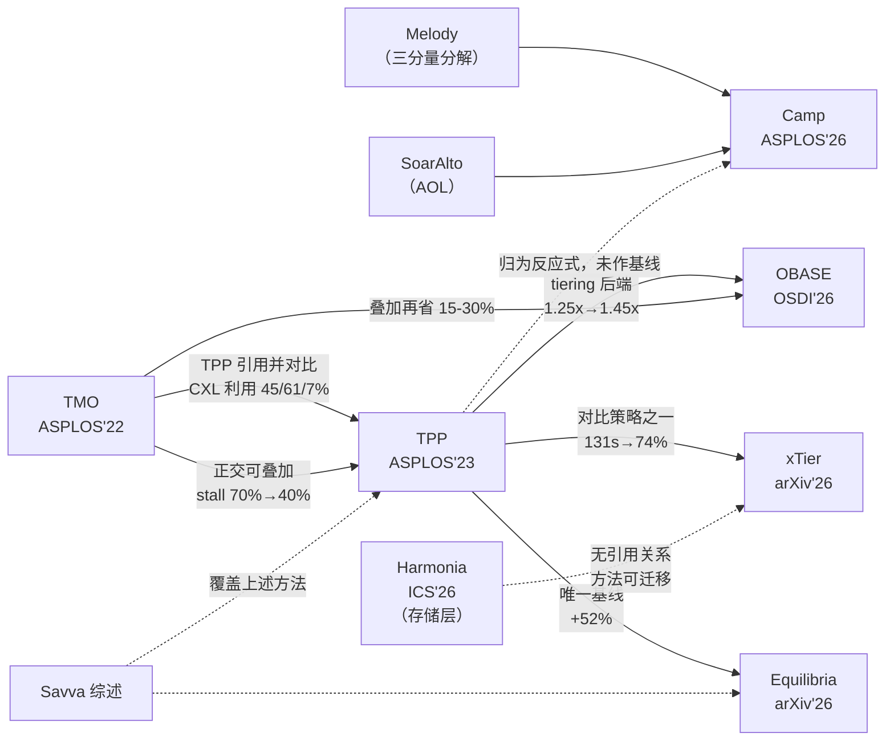

# 论文索引与阅读地图

本目录存放**中文总结**（每篇一份）与**完整翻译**（部分论文）。所有 PDF 在 `../papers/`。

**命名约定**：`<第一作者>-<年份>-<会议>-<主题>-<类型>.md`；`-总结.md` = 两页速览（问题/机制/数字/局限/判断），`-完整翻译.md` = 全文逐节翻译。

**使用建议**：先读总结的"一句话"与"关键数字"两张表；需要复现或引用具体机制时再翻完整翻译或原文；`.md` 里的数字均带页码或章节锚点。

---

## 一、总索引

| # | 论文 | 年份·会议 | 主题标签 | 总结 | 全文翻译 | PDF |
|---|---|---|---|---|---|---|
| 1 | **TMO**: Transparent Memory Offloading in Datacenters | ASPLOS '22 | 反馈控制 · 生产部署 · PSI | [总结](Weiner-2022-ASPLOS-TMO-Transparent-Memory-Offloading-in-Datacenters-总结.md) | — | [PDF](../papers/Weiner-2022-ASPLOS-TMO-Transparent-Memory-Offloading-in-Datacenters.pdf) |
| 2 | **TPP**: Transparent Page Placement for CXL-Enabled Tiered-Memory | ASPLOS '23 | 页级分层 · 已进主线内核 | [总结](Maruf-2023-ASPLOS-TPP-Transparent-Page-Placement-for-CXL-Enabled-Tiered-Memory-总结.md) | — | [PDF](../papers/Maruf-2023-ASPLOS-TPP-Transparent-Page-Placement-for-CXL-Enabled-Tiered-Memory.pdf) |
| 3 | **Equilibria**: Fair Multi-Tenant CXL Memory Tiering At Scale | arXiv 2026 | 多租户公平 · cgroup 旋钮 | [总结](Equilibria-2026-arXiv-Fair-Multi-Tenant-CXL-Memory-Tiering-总结.md) | — | [PDF](../papers/Equilibria-2026-arXiv-Fair-Multi-Tenant-CXL-Memory-Tiering.pdf) |
| 4 | **Camp**: Performance Predictability in Heterogeneous Memory | ASPLOS '26 | 解析性能模型 · 交织决策 | [总结](Liu-2026-ASPLOS-Performance-Predictability-in-Heterogeneous-Memory-总结.md) | — | [PDF](../papers/Liu-2026-ASPLOS-Performance%20Predictability%20in%20Heterogeneous%20Memory.pdf) |
| 5 | **OBASE**: Object-Based Address-Space Engineering to Improve Memory Tiering | OSDI '26 | 对象级布局 · 编译器运行时 | [总结](Banakar-2026-OSDI-OBASE-总结.md) | [翻译](Banakar-2026-OSDI-OBASE-中文翻译.md) | [PDF](../papers/Banakar-2026-OSDI-OBASE-Object-Based-Address-Space-Engineering-to-Improve-Memory-Tiering.pdf) |
| 6 | **xTier**: Intelligent Tiering for CXL-Enabled Memory | arXiv 2026 | 内核 eBPF · 学习排序 | [总结](xTier-2026-arXiv-Intelligent-Tiering-for-CXL-Enabled-Memory-总结.md) | — | [PDF](../papers/xTier-2026-arXiv-Intelligent-Tiering-for-CXL-Enabled-Memory.pdf) |
| 7 | **Harmonia**: Data Placement and Migration in HSS via MARL | ICS '26 | 多智能体 RL · **存储层** | [总结](Nadig-2026-ICS-Harmonia-总结.md) | [翻译](Nadig-2026-ICS-Harmonia-完整翻译.md) | [PDF](../papers/Nadig-2026-ICS-Harmonia-Enhancing-Data-Placement-and-Migration-in-Hybrid-Storage-Systems.pdf) |
| 8 | **Savva 等**: ML-Based Caching and Tiering — A Survey | ACM CSUR 58(11), 2026 | 综述 · 方法地图 | [总结](Savva-2026-ACMCSUR-ML缓存与分层综述-翻译总结.md) | [翻译](Savva-2026-ACMCSUR-ML缓存与分层综述-完整翻译.md) | [PDF](../papers/Savva-2026-ACMCSUR-Machine%20Learning-Based%20Caching%20and%20Tiering%20in%20Modern%20Data%20Storage%20Systems%20-%20A%20Survey.pdf) |

**厂商文档（非论文，不单独做总结）**：AMD MEXT 的三份白皮书（PrimeTime 6th Gen、PrimeTime 1.5TB、Agentic AI）、安装指南与产品简介，其分析与数据已并入根目录 [`AMD-MEXT-技术洞察报告.md`](../AMD-MEXT-技术洞察报告.md)。PDF 位于 `../papers/AMD-2026-*`、`../papers/amd-mext-product-brief.pdf`。

---

## 二、一句话结论速查

| # | 一句话 |
|---|---|
| 1 TMO | 用 PSI 把"内存压力"从代理指标换成"损失的工作量"，生产数百万台机器省 **20–32%** 内存，CPU 开销仅 0.05%。 |
| 2 TPP | 把 CXL 当"可降级的 NUMA 节点"而非 swap：异步 demote + 水线解耦 + hint fault 一拍迟滞，达到理想基线 **<1%** 差距，已进内核 v5.18。 |
| 3 Equilibria | 给分层加多租户公平：每容器 `lower protection`/`upper bound` 两个旋钮 + 分层可观测 + thrashing 抑制，比上游（TPP）最高 **+52%**。 |
| 4 Camp | 不在 CXL 上跑也能预测减速：三个有微架构因果的分量，265 负载相关性 **0.97**（热度类指标仅 0.37–0.88）。 |
| 5 OBASE | 先改对象布局再分层：热对象聚成纯热页，使未修改的 kswapd/TMO/TPP/Memtis 收益 2–4×，代价 2–5%。 |
| 6 xTier | 把排序决策搬进内核：eBPF + PEBS + 34 µs MLP，1:15 下 18 配置中 14 最快，迁移量少 13–22×。 |
| 7 Harmonia | 放置与迁移必须拆给两个智能体：单智能体联合优化反而差 **21.9%**，拆开后优于最佳基线 **29–39%**（存储层）。 |
| 8 Savva 综述 | 系统梳理 ML 在缓存淘汰/准入/预取与分层放置/迁移中的用法，提供方法分类与证据强度评估。 |

---

## 三、按问题聚类

### A. 页级分层系统（"把页搬到该去的地方"）

| 论文 | 决策依据 | 执行机制 | 主指标 |
|---|---|---|---|
| TMO | PSI（应用侧损失） | 内核 reclaim + zswap/SSD 后端 | 内存节省 % |
| TPP | LRU + hint fault + 一拍迟滞 | 异步 migrate 到 CXL 节点 | 吞吐（归一化到 All-Local） |
| Equilibria | 每容器份额（protection/bound） | cgroup + demote/promote 调节 | 各租户 SLO 达成 |
| xTier | 学习排序（32 特征 MLP） | eBPF 决策 + 内核模块批量 migrate | 归一化加速比 + 迁移量 |

### B. 改变输入而非策略（"让后端更容易判断"）

| 论文 | 做法 | 为什么不改后端 |
|---|---|---|
| OBASE | 动态重组虚拟地址空间，使页内冷热一致 | 后端（kswapd/TMO/TPP/Memtis）零修改即可受益 |

### C. 先算再决定（"不部署也能预测"）

| 论文 | 产出 | 前提 |
|---|---|---|
| Camp | 三分量减速模型 + 闭式最优交织比 | 设备带宽未饱和；需 11–12 个 PMU 计数器 + 每平台一次标定 |

### D. 方法论 / 跨层

| 论文 | 层次 | 可迁移的结论 |
|---|---|---|
| Harmonia | 存储（SSD/HDD/PMEM） | 目标与时间尺度不同的任务必须拆给不同智能体，靠奖励耦合 |
| Savva 综述 | 缓存 + 分层 | 方法分类学与证据强度地图，用于定位自己的工作 |

---

## 四、互相引用的真实关系（已逐篇核对参考文献）

**要点**：
- **TPP 是公共坐标系**：OBASE、xTier、Equilibria 全部以它为基线，因为它进了主线内核（v5.18），"和 TPP 比"是可复现的承诺。
- **TMO 与 TPP 不是竞争而是串级**：TPP 把 TMO 的换出路径变成"先 demote 再 swap"，进程 stall 70%→40%、内存节省 13.5%→16.5%。
- **Camp 的基线集合与其余论文不重叠**（NBT/Colloid/Alto/Soar/Caption），它与 TPP 只有"相关工作归类"的关系。
- **Harmonia 与内存分层无引用关系**，仅在"策略该不该拆"这个方法论问题上可比。

---

## 五、指标口径对照（用于跨论文比较）

| 论文 | 主指标 | 分母/基线 | 是否给误差 |
|---|---|---|---|
| TMO | 内存节省 %（在固定尾部延迟目标下） | 部署前自身 | 无（生产 A/B） |
| TPP | 吞吐，归一化 | Ideal All-Local | 3 次运行取平均 |
| Equilibria | 各租户 SLO 达成 + 相对吞吐 | Linux/TPP | 未报 CI |
| Camp | 预测误差（%/相关性） | 实测减速 | 按负载分布给出 |
| OBASE | 页利用率 + RSS | 无 OBASE 基线 | 未报 CI |
| xTier | 归一化加速比 + 迁移量 | 最慢 system-ratio 配置 | 未报 CI |
| Harmonia | 平均 I/O 延迟 | Fast-Only | 3 次运行取平均 |
| MEXT 白皮书（厂商） | 保留率 = 保留性能 / 保留 DRAM 比例 | all-DRAM 同容量 | 无标准差 |

**可对比性的坑**：只有 MEXT 白皮书把结果折算成"每 DRAM 美元"，其余全是无量纲比值；Camp 报的是**预测误差**而非系统性能，与其他六篇不同层。跨论文引用数字时必须先对齐分母。

---

## 六、尚未翻译/总结的部分

| 项目 | 状态 |
|---|---|
| TMO / TPP / Equilibria / Camp / xTier | 只有总结，无全文翻译（篇幅 13–17 页） |
| AMD MEXT 白皮书 ×3 + 安装指南 + 产品简介 | 无独立总结，内容已并入 `AMD-MEXT-技术洞察报告.md` |
| `xtier/xTier-2026-...pdf` | 与 `papers/` 中同名文件字节相同，属重复副本 |

需要哪篇补全文翻译，直接在会话里点名即可。
