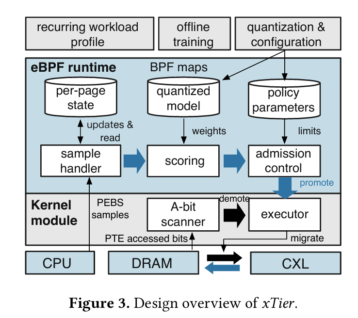

# xTier 技术洞察报告

**日期：** 2026-11-18
**分析对象：** xTier — 用机器学习决定内存页放哪儿的系统（arXiv 2609.27266）
**代码基础：** `/Users/bbchen/workspace/research-mext/xtier/xtier/`（全开源）

---

## xTier 是干什么的

服务器的内存分两档：**快的 DRAM（贵）和慢的 CXL 内存（便宜）**。工作负载的所有页一开始都放在慢层，xTier 的任务就是——**盯着哪些页被频繁访问（热页），把热页搬到 DRAM；把 DRAM 里没人碰的页（冷页）搬到 CXL**。

一句话：**热页上移、冷页下移，让宝贵的 DRAM 只装真正被用到的数据**。效果：在 DRAM 很紧张（如 1:15 配比）的配置下，多数测试场景里它是最快的分层方案；整个决策过程在内核里只要约 55 微秒，稳态只吃不到 1 个核的 4%。

---

## 一、页是怎么换入换出的

热页换入和冷页换出走的是**两套完全不同的机制**——这是 xTier 最有特色的设计。



**图 3. xTier 设计总览（原文 Figure 3）。** 图分四层，自上而下正好是"谁来决策、谁来看冷、谁来搬、搬到哪"：

- **最上层（离线，灰色）**：`recurring workload profile`（重复运行的负载画像）→ `offline training`（离线训练）→ `quantization & configuration`（量化与配置）。这是**内核之外**的一次性准备，对应下文"训练约 15 分钟、全自动"。
- **eBPF runtime（蓝色，热页上移的决策层）**：三张 BPF map 承载状态——`per-page state`（逐页记账）、`quantized model`（INT8 权重）、`policy parameters`（策略参数）。数据流是一条单向管道：`sample handler`（收 PEBS 采样并记账）→ `scoring`（MLP 打分）→ `admission control`（门控：冷静期 / Top-K / 抽签），只有通过门控的页才 `promote` 下去。
- **Kernel module（灰色，执行层）**：上半部分的 `A-bit scanner` 走 `demote` 路径——扫页表 A 位判冷，然后把页降级；`executor` 既接 eBPF 下来的 `promote` 单，也执行 `migrate` 动作。
- **最底层（硬件）**：`CPU` 供 PEBS 采样（上行箭头），`DRAM` 与 `CXL` 之间是双向箭头——黑色粗箭头下移（降级到 CXL），蓝色箭头上移（晋升到 DRAM）。

一句话读法：**上面蓝框是"AI 决定谁上"，左边灰框是"硬件位决定谁下"，两者最后由 executor 统一动手，在 DRAM 与 CXL 之间双向搬运。**

### 热页上移：靠"预测"

**先看硬件给了什么**：Intel CPU 有个叫 PEBS 的采样功能——程序每访问若干次内存，CPU 就自动记录一条"某某地址被访问了"。xTier 用一个 eBPF 程序接收这些采样，给每个页记账：这个 epoch（几毫秒的时间片）被访问了几次、过去 6 个 epoch 的访问趋势如何。

**然后做预测**：每隔一个 epoch，攒下的"候选页"（还在慢层、可能值得搬上来的页）被送进一个小神经网络（MLP），它给每个页打个分——**预测这个页未来还会不会被频繁访问**。分数高的页胜出。

**但高分不是终点**，还要过三道关卡：

1. **冷静期**：刚搬过的页 15 个 epoch 内不许再搬（防止来回折腾）；
2. **名额限制**：每个 epoch 只录取分数最高的那一小撮（DRAM 预算有限，装不下所有热页）；
3. **概率抽签**：最后一道骰子，控制迁移总量。

过关的页排进一个队列，由一个内核模块（executor）取出来，**把相邻的页合并成一整段**，调用一个内核补丁提供的搬家函数，一次性搬到 DRAM。

### 最后一棒：实际搬页是"三级接力"，patch 只负责其中一环

一个"过关页"从决策到落位 DRAM，经过三个角色，各自实现方式不同：

| 环节 | 谁来做 | 怎么实现 | 要改内核吗 |
|---|---|---|---|
| ① 下单 | eBPF 程序 | 往共享队列写一条"迁移意图"（地址 + 进程号 + 目标节点） | 不要 |
| ② 理货 | executor.ko 内核模块 | 后台线程定期取单，按地址排序、相邻页拼成整段 | 不要（模块可动态加载） |
| ③ 实际搬页 | 补丁内核里的新函数 | `xtier_migrate_range()` 执行真正的页迁移 | **要——全内核唯一一处改动** |

#### 这个 patch 是什么（简单描述）

它就是给内核**新加了一个"搬家函数"**，全部内容约 90 行代码、加在 Linux 的内存管理代码里（`mm/mempolicy.c`）。函数名叫 `xtier_migrate_range()`，翻译成人话就是："**把这个进程的这段地址，搬到指定内存节点去**"。

为什么非要加它？因为 Linux 内核里会搬页的函数都是"内部使用"，不对外开放——**外面的程序根本调不到**。现成的两条路都走不通：

- 内核自带的迁移函数 → 没挂到"公开目录"（导出符号表）上，模块链接不到；
- 用户态的 `move_pages()` 系统调用 → 只能搬**自己进程**的页，而 executor 是个内核线程，要搬的是**别的进程**的页。

所以 patch 做的事就一件：**包一个安全的搬运函数，把它挂到公开目录上（GPL 导出）**，让 executor 模块能链接到它。函数内部没有发明任何新的搬家技术——就是遍历这段地址、把页挂上 Linux 自带的待迁列表、调用内核原生的迁移机制、在目标节点分配新页。两个讲究的设计：

- **大页不拆**：按源页的原始大小分配，不悄悄把大页拆成碎片；
- **满了就失败**：目标节点（DRAM）满了这次迁移就失败，**绝不悄悄搬回原处**——否则"晋升"会静默变成什么都没做，系统还以为成功了。

**验证方式很直接**：没打补丁的内核上加载 executor 模块，当场报"找不到符号"错误。所以部署 xTier 必须重新编译内核并重启——这是它和研究对手（完全不改内核的商业方案）最本质的工程差异，也是学术界"分层系统难以进入内核主线"现实的一个缩影。

#### executor：搬页的"执行队"，全系统唯一的劳力角色

executor（`xtier_executor.ko`）是一个标准的可动态加载内核模块，角色定位很纯粹——**前面所有人动嘴，它动手**。内部就是一个后台线程，干四件事：

1. **取单**：定期（起步每 10ms）从队列里把"迁移意图"捞出来；队列空了就自动拉长休眠（最长 1 秒醒一次），几乎零开销；
2. **理货**：把这一批页**按地址排序，相邻的拼成整段**——变热的页往往是一整片数组，一次搬一整段比逐页搬几十次划算得多。每轮有个搬运量上限（默认 64 页），避免一口气搬家把系统卡住；
3. **搬运**：对每一段调用一次 patch 提供的搬家函数；搬完立刻把结果记回账本（这页现在在哪层、什么时候搬的），前面的门控因此立即生效；
4. **扫冷页**：前面说的 PTE 扫描器也住在这个模块里，管降级方向。

它还提供一个保底能力：**没有性能采样硬件（PEBS）的机器上**，它可以用页表扫描来"人工采样"（扫到 A 位被置位的页就当作一次访问上报），让整条流水线照样运转——这是作者为实验完整性留的备用通道。

三个角色怎么接上头？靠一张**共享表格**（BPF map，可以理解为内核里一块约定好格式的公告板）：eBPF 往里写单，executor 从里取单，用户态控制程序往里写配置、读统计。谁也不直接叫谁，全靠公告板协作——这也让三方（eBPF、内核模块、用户态程序）能用三种完全不同的技术形态配合工作。

### 冷页下移：靠"硬件的访问位"，完全不靠 AI

为什么不也用 AI 判冷？因为采样有运气成分——一个还温着的页可能只是碰巧没被采样到，误判会造成灾难（搬下去又得搬回来）。而 CPU 的页表里有个 **Accessed 位**：每次访问硬件自动置 1，**绝对不会漏**。

executor 模块里有个扫描器，定期遍历工作负载的页表：

- A 位是 1 → 这页最近被碰过，是温的，把 A 位清零，下次再看；
- A 位是 0 → **从上次扫描到现在一次都没被访问 → 冷页**，直接打包搬到 CXL。

这条路径不经过神经网络、不进队列，简单直接。而且很省：只有 DRAM 快被塞满（占用超七成）时才启动扫描，DRAM 有空位就干脆不扫。

### 为什么不会"来回折腾"

系统里有个**容量账本**：搬上去一页加一，搬下来一页减一。账本同时卡住两件事——上移的名额和下移的触发水位。**上移和下移在同一个账本上互相牵制**：热页上移让账本变满，才允许冷页扫描器启动腾地方；腾出地方后又给上移放名额。一收一放，自动平衡。

---

## 二、模型的数据从哪来

模型是个监督学习问题：输入是页的"访问画像"，标签是"这页未来值不值得搬"。两边的数据都有明确来源。

### 输入：32 个数字描述一个页

| 信息 | 具体内容 | 怎么来的 |
|---|---|---|
| **访问热度** | 本 epoch 被访问几次、过去 6 个 epoch 各多少次、变化趋势（在变热还是变冷）、多久没被访问了、上次晋升后过了多久 | eBPF 对 PEBS 采样的逐页记账（自动、实时） |
| **页的"身份"** | 是栈/堆/代码段/普通数据？可读可写可执行？所在内存区多大？匿名还是共享？ | 用户态程序启动时扫一遍 `/proc/pid/maps`，预先填好 |

注意：**没有任何需要应用配合的数据**——整个采集对工作负载完全透明。

### 标签：未来 10 个 epoch 的真实访问（"事后对答案"）

采集数据时系统会继续记账，所以事后可以知道每个页"未来 10 个 epoch 里被访问了多少次"。标签就叫 **benefit（收益）**：

> 很快被再次访问、访问频繁且持续的页 → 高分；被摸一下就再也不碰的页 → 零分。

这样模型学的不是"这页现在热不热"，而是"**把这页搬上去值不值**"——一个只在瞬间热的页和一个持续热的页，当下看都一样热，但只有后者值得占 DRAM。

### 训练流程（约 15 分钟，全自动）

1. 用占位权重先把系统编译起来（解决"采数据需要系统、系统需要模型"的鸡蛋问题）；
2. 让真实负载跑在慢层上，系统把每页每 epoch 的特征记录成 CSV（几个 GB）；
3. 脚本对每条记录计算 benefit 标签、训练、量化成 INT8、导出一个 113KB 的权重文件；
4. 重新编译加载器（权重是编译进去的，不是运行时加载的）。

一个重要约束：**模型必须在自己机器、自己负载上训练**——访问模式因负载而异，这也是官方仓库不带训练好模型、坚持"谁用谁训"的原因。

---

## 三、模型结构与推理开销

### 3.1 模型结构

一个非常标准的三层前馈网络（MLP，代码里叫 `RegMLP`）：

```
输入层：32 个特征（一个页的访问画像 + 身份信息）
   ↓
全连接层 0：32 → 192 个神经元，ReLU 激活
   ↓
全连接层 1：192 → 96 个神经元，ReLU 激活
   ↓
输出层：96 → 1 个数（这个页的未来收益分）
```

- 结构上没有任何花哨的东西：**没有注意力、没有循环、没有 softmax**，就是矩阵乘 + ReLU，是神经网络里最古老最简单的形态。
- 输出是**连续分数**（回归），不是热/冷二分类——下游 Top-K 录取靠的是分数的排序，不是绝对值。
- 全部**量化为 8 位整数（INT8）**推理：权重是 int8，偏置是 int32，层间的缩放用"乘一个数再移位"实现——因为内核 eBPF 环境里没有浮点运算。

### 3.2 为什么选这么简单的模型

不是不想用大的，是**环境不允许**：

1. **推理在内核里**：决策路径每一步都在内核（这是 55µs 延迟的来源），内核 eBPF 环境只能跑"可被证明安全终止"的代码——一个固定大小的矩阵乘可以，变长结构的复杂模型不行；
2. **指令数有上限**：单个 eBPF 程序约 100 万条指令的预算，矩阵乘要展开写成固定循环，还得拆成三段用"尾调用"串起来才塞得下；
3. **32 个统计特征不需要大模型**：时间信息已经由"过去 6 个 epoch 窗口"的特征工程编码好了，MLP 吃这种表格数据绰绰有余。

### 3.3 推理开销：小到可以忽略

| 项 | 数值 |
|---|---|
| 一次推理的计算量 | 约 2.5 万次整数乘加（32×192 + 192×96 + 96×1 = 24,672） |
| 一次推理耗时 | 约 60 微秒 |
| 模型大小 | 114 KB |
| 稳态 CPU 占用 | 不足 1 核的 4% |
| 系统常驻内存 | 约 218 MB（几乎全是页状态记账表） |

直观点说：**这个"AI"比一张照片还小，一次推理比一次鼠标点击还快**。而且进入模型的页已经过层层筛选（已在 DRAM 的、代码段、冷静期内的都提前排除了），实际推理量正比于"待决策的页数"而不是全部访问。

---

## 四、论文的实验结论（arXiv 2609.27266 原文口径）

实验设置：**6 个内存密集负载**（XGBoost、LightGBM、GAP 图计算的 BC/TC/BFS/PR）× **5 档 DRAM:CXL 配比**（1:5 到 1:25），对比四个真系统基线：AutoNUMA、TPP、Memtis、FreqTier。

### 主结果：紧配置下几乎全胜，而且搬家少一两个数量级

- **DRAM:CXL ≥ 1:15 时，18 种配置里 14 种 xTier 最快**；不是最快的 4 种平均只落后最佳基线 3.9%。DRAM 越紧张优势越明显，松配置下各系统差别不大；
- **几何平均只搬 13 倍少的页，紧配比下少 22 倍**——性能持平或更好的同时迁移量小一两个数量级。增益来自"搬得准"而不是"搬得勤"；
- **相位变化恢复碾压**：热集整体迁移的瞬间，xTier 几秒内开始回升、最终覆盖 94% 的新热集；基线都要经历长平台期——Memtis 停滞 60 秒才到 55%，TPP 131 秒到 74%，FreqTier 216 秒才 30%。

### 消融：增益归因拆得很干净

- **去掉过滤器栈 → 实验直接跑不完**：每条采样都要推理（34µs/次），迁移请求堆得比消化快，系统失速。说明那套"冷静期 + Top-K + 容量帽"门控不是锦上添花，是能跑的前提；
- **保留过滤器、把 ML 换成简单频率打分 → 能跑但更慢**：ML 的贡献被隔离在"排序质量"上；
- 特征重要性分析印证了设计：最有用的特征是** epoch 间访问差分和多 epoch 命中历史**——"需求在涨还是在退"比"累计访问了多少"更有预测力，这正是 MLP 胜过频率启发式的机制性解释。

### 模型质量与泛化

- 排序 AUC 0.767（LightGBM）/ 0.791（XGBoost）/ 0.848（PageRank），随机打分为 0.5；
- INT8 量化后与浮点版的**秩相关 >0.98**——排序几乎无损（下游靠排序不靠绝对值，这个指标选得准）；
- 同负载换不同输入，模型精度差仅 0.1–0.4%——**一次训练可跨输入复用**，支撑"训练成本摊销在重复运行上"的部署假设。

### 开销（论文自报，RQ4）

| 项 | 数值 |
|---|---|
| 稳态 CPU | <1 核的 4%（启动/相位切换时更高） |
| 常驻内存 | ~218 MB（约 80GB 节点的 0.27%，几乎全是页状态表） |
| 迁移执行线程 | <0.02% 核 |
| 采样命中率 | 少于 1/5 的样本进推理、少于 1% 产生实际晋升；布局稳定后进推理的不足 1% |
| 训练成本 | 每负载一次性 15 分钟（采集 12–15 分钟 + 训练 1–2 分钟纯 CPU） |

一个论文诚实测出的代价曲线：采样率拉满时 CPU 会到 25% 核——所以自适应降采样（收敛后自动放慢）不是优化项而是必需品。

### 怎么看这些数字

可信度较高的理由：基线全是真系统（AutoNUMA/TPP 在内核主线，Memtis 有公开实现）、消融完整、**figures/ 目录里每张图的数据和绘图脚本都随仓库提交可复现**。需要保留的怀疑：负载全部自选、无第三方复现、实验平台是较老的 Haswell-EP（新一代服务器上 CXL 延迟特性不同）、94% 相位恢复用的是刻意构造的热集迁移 microbenchmark。但"搬家少一个数量级还持平或更快"很难造假——它直接来自门控架构，机制上说得通。

---

## 五、交付件（部署需要什么）

| 交付件 | 是什么 |
|---|---|
| **一个打过补丁的 Linux 内核** | xTier 需要内核导出一个页迁移函数，主线内核没有——这是最大的部署门槛（必须换内核重启）。补丁本身极小：只加一个约 90 行的搬运函数 |
| **xtier_executor.ko** | 内核模块，负责实际搬页和冷页扫描 |
| **pebs_mlp_kern.o** | eBPF 程序（决策逻辑，注意交付形态是字节码不是 .ko） |
| **page_profiler_user** | 用户态控制程序，**模型权重编译在内**，换模型要重编译 |
| **自己训练的模型** | 仓库不带，15 分钟自己训 |

---

## 六、和 AMD MEXT 的关系（详见《AMD-MEXT-技术洞察报告.md》）

两者解决同一个问题，形态是两个极端：

| | xTier | AMD MEXT |
|---|---|---|
| 定位 | 学术研究原型 | 商业产品 |
| 慢层 | CXL 内存 | NVMe 固态盘 |
| 决策 | 小 MLP 在内核里，55 微秒 | 模型集成在用户态，秒级 |
| 部署 | 要换内核、要自训模型 | 装完就能用，内置模型 |
| 开源 | 全开源可复现 | 闭源 |

xTier 证明了"这个决策可以快到微秒级地放进内核"，MEXT 证明了"这个能力可以打包成不碰内核的商品"——同一个方向的研究端和产品端。
